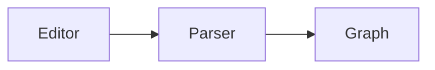

# kknow

kknow is a fast, local-first knowledge base for plain Markdown files. It uses
Rust and Tauri.

Markdown files are the source of truth. A vault is an ordinary folder of `.md`
files, and any editor can open it. All other data is a cache that kknow can
build again. This data is the link graph, the search index and the sync state.

## Status

All functions in this document work:

- the core and the command-line interface (CLI);
- a window with an editor and live preview;
- search in all vaults at the same time;
- sync with S3-compatible storage (the Amazon S3 protocol) and with a plain folder;
- themes;
- settings in a separate window;
- custom commands for a note, a folder, a vault or a file outside a vault.

[TODO.md](TODO.md) lists the remaining work.
[ARCHITECTURE.md](ARCHITECTURE.md) tells how kknow works inside and why it has
this design.

## Layout

```
crates/
  kknow-core   vault model: Vault, Note, NoteId
  kknow-index  markdown parsing, link graph, HTML rendering, tantivy search
  kknow-sync   sync: manifest, conflicts, configuration, S3 and folder
  kknow-run    custom commands: manifest, interpreters, running with a timeout
  kknow-app    open vaults, registry and settings, index, file watching, themes
  kknow-cli    the kknow binary: the same data in the terminal
src-tauri/     desktop app: commands on top of kknow-app
ui/            interface: TypeScript, Vite, CodeMirror 6; two windows — the main
               one (`src/main.ts`) and settings (`src/settings/main.ts`)
```

`kknow-core` knows nothing about text parsing. `kknow-index` knows nothing about
the disk. `kknow-app` knows nothing about how the window shows the data. Thus
the CLI and the desktop app use the same core. Search and file watching came to
the core with no change in the user interface (UI).

## Installation

### Homebrew (macOS)

On macOS, you can install the app with [Homebrew](https://brew.sh) from the
[akuchin/homebrew-kknow](https://github.com/akuchin/homebrew-kknow) tap:

```bash
brew install --cask akuchin/kknow/kknow
```

The cask is for Apple Silicon only. The command installs `kknow.app` into
`/Applications`. The app then updates itself (see "Updates" below). Thus
`brew upgrade` skips it. To update it through Homebrew, run
`brew upgrade --cask --greedy kknow`.

About the quarantine: the app has no Apple signature, so macOS puts the
downloaded app in quarantine, and Gatekeeper calls it "damaged". The cask
removes the quarantine flag after each installation and upgrade, so the app
opens at once. If macOS still refuses to open the app, remove the flag
yourself:

```bash
xattr -dr com.apple.quarantine /Applications/kknow.app
```

### Prebuilt binaries

The [Releases](https://github.com/akuchin/kknow/releases) page has prebuilt
binaries:

- the app for macOS (Apple Silicon — `aarch64` only; there is no build for Intel Macs);
- the app for Linux (`.deb`, `.rpm`, `.AppImage`);
- the app for Windows;
- archives with the `kknow` CLI for the same platforms.

The app has no signature. On macOS, Gatekeeper calls an unsigned app from the
internet "damaged". Move the app to `/Applications`, then remove the quarantine
flag:

```bash
xattr -dr com.apple.quarantine /Applications/kknow.app
```

### Updates

The app checks for a new version in the background. The first check is 15
seconds after the start, and the next checks come each 6 hours. The app
downloads a new version without a question. Then the status bar shows
**Restart to update**. Click it, and kknow saves the note and starts the new
version. If you quit without the button, the new version installs on quit. On
Windows, the update installs only from the button.

To stop the background checks, turn off **Settings → General → Update
automatically**. The **Check now** button works also when the setting is off.
The app menu has **Check for Updates…** too.

The check is a GET request to the `latest.json` file of the latest GitHub
release. The app sends no data about you or your notes. Each update archive
has a signature, and the app does not install an archive with a bad signature.

A developer build never checks: `pnpm dev` and `pnpm install:app` give version
0.0.0.

### Making a release

The git tag is the version. Make a tag and push it:

```bash
git tag -m "kknow v0.1.4" v0.1.4
git push origin v0.1.4
```

GitHub Actions (`.github/workflows/release.yml`) writes the version from the
tag into `Cargo.toml` and builds the release. The CLI, the app and the names of
the release files get this version. In the repository, `Cargo.toml` keeps
`0.0.0`, so a local build shows 0.0.0. The tag must look like `vX.Y.Z`,
otherwise the workflow stops at once.

At the end, the workflow puts the new version and checksum into the Homebrew
cask. For this, the repository needs the `HOMEBREW_TAP_TOKEN` secret: a
fine-grained token with "Contents: Read and write" access to
`akuchin/homebrew-kknow` only. Without the secret, the release still works, and
you update the cask by hand.

The update archives need a signing key. Make it one time:

```bash
pnpm tauri signer generate -w ~/.tauri/kknow.key
```

1. Put the public key (`~/.tauri/kknow.key.pub`) into
   `plugins.updater.pubkey` in `src-tauri/tauri.conf.json`.
2. Put the private key into the `TAURI_SIGNING_PRIVATE_KEY` secret.
3. Put its password into the `TAURI_SIGNING_PRIVATE_KEY_PASSWORD` secret.

Without the key or the public key, the workflow stops before it makes the
release. Keep a copy of the private key in a safe place. If you lose it, the
installed apps cannot accept the next versions.

The release stays a draft until all platforms are built. The apps read
`latest.json` from the latest published release. Thus they never see a
release that has no `latest.json` or only some platforms.

## Running the app

Install the dependencies one time from the repository root. `ui` is a pnpm
workspace package, so all packages share one install:

```bash
pnpm install
```

Then run all commands from the root. `tauri` searches for
`src-tauri/tauri.conf.json` relative to the current directory:

```bash
pnpm dev
```

This command starts Vite, builds the app and watches for changes in all core
crates. The window opens on the active vault from the shared list. You can also
give a directory as an argument: `kknow-desktop ~/notes` adds it to the list and
makes it active.

You can work on the interface without Tauri. Stubs replace the commands, and the
page opens in a regular browser:

```bash
pnpm ui:mock
```

The settings window is also available there, as the `/settings.html` page.

## Building the app

```bash
pnpm build:app
```

The command puts `kknow.app` in `target/release/bundle/macos/`. The app has no
signature, so macOS asks for confirmation at the first start from Finder.
Right-click the app and select "Open".

The full `pnpm build` also makes a `.dmg`. Its bundler uses Finder to arrange
the disk image window. Run this command from your own terminal, because your
terminal has access to Finder.

## Running the CLI

```bash
cargo run -p kknow-cli -- --vault testdata/vault stats
```

You can set the directory with the `KKNOW_VAULT` variable. `--vault` also
accepts a vault name from the shared list (`kknow vaults`). The window uses the
same list. The CLI has these commands for notes: `list`, `stats`,
`links <note>`, `backlinks <note>`, `tags`, `broken`, `orphans`, `show <note>`,
`render <note>`, `new <name>`, `search <query>`. It also has these commands:
`watch`, `themes`, `vaults`, `sync`, `commands`, `run`, `bookmarks`,
`bookmark <note> <line> [--name <name>]`, `tasks [--all]`, `trash`.

```bash
kknow vaults add ~/notes --name Personal   # add a vault to the list
kknow vaults                               # list: active one marked, ⌘1…⌘9
kknow vaults use Personal                  # active: the window opens with it
kknow vaults rm Personal                   # forget; files on disk stay
kknow --vault Personal stats               # work with it by name
```

## What the parser understands

- `[[link]]`, `[[link|alias]]`, `[[link#Heading]]`, `[[link#^block]]`
- embeds `![[note]]` and Markdown links `[text](note.md)`
- tags `#tag` and `#nested/tags`
- YAML frontmatter, the metadata block at the top of a note. For now the parser
  removes it. Field parsing comes later.
- The parser skips code and math: `` `[[this is not a link]]` `` is not a link.
- The preview shows a code block in the `mermaid` language as a diagram.
- Comments for an agent: `words<!-- @agent «words»: task -->`. The editor
  highlights the words and hides the comment. To add a comment, select the
  words, right-click and choose "Add comment", or press ⌘⇧M. Without a
  selection the comment goes to the whole paragraph:
  `<!-- @agent: task -->` at its end. The same menu edits or removes the
  comment under the cursor. A line with a comment has an icon on the left of
  the text. Click the icon to open the comment. The comment form
  has a "Remove" button, and a comment saved empty is removed too. The 💬 button in the header lists all comments in
  the text. Click one to go to its words.

Short links follow the usual wiki rules. kknow tries the full path first, then
the file name, then a path suffix. If many notes have the same name, kknow
selects the note that is closest in the folder tree.

When you rename or move a note or a folder, kknow updates the links to it in
the other notes. A short link that still finds the note stays as it is. Links
in code stay too. The status bar tells how many notes changed.

The preview does not show raw HTML from a note. A note can come from another
person's vault or from sync. A script in it would run with the app's
privileges.

## Images

The preview and the editor both show an image from a note:

```markdown
        path from the note or from the vault root
![[screenshot.png]]                file name — searched across the whole vault
    width 300 px; `|300x200` — width and height
![[screenshot.png|300]]            the same for an embedded image
```

A large image must not prevent reading. Thus an image is never wider than the
text column. Its maximum height is 480 px (pixels), or 360 px in the editor.
Click an image to show it in the full window. Press Esc to close it.

To add an image, paste it from the clipboard (⌘V) or drop an image file on the
editor. kknow saves it into the `attachments/` folder at the vault root and
inserts a link:

```markdown
![[attachments/Pasted image 20261024153012.png]]
```

A pasted image gets the date and time in its name. A dropped file keeps its
name. kknow never overwrites a file: it adds a number, `shot 2.png`. For a
standalone file, the `attachments/` folder is next to the file.

kknow reads only images, and only in the vault. It does not load images from the
web (`https://…`). A note from another person's vault must not tell a
third-party server that you opened it.

## Diagrams

The preview shows a code block in the `mermaid` language as a picture:

````markdown

````

The core writes this block as `<pre class="mermaid">` with the source in it.
The window draws the picture. Mermaid is JavaScript, and JavaScript does not
belong in the core. Thus `kknow render` prints the diagram source, not a
picture.

The window loads the library at the first diagram, not at startup. Most notes
have no diagrams. The colors follow the selected theme. When the theme changes,
the window draws the diagrams again. Mermaid has its own palette and does not
read CSS.

If mermaid cannot parse a diagram, the block stays as text. Below it, mermaid
shows its error with the line number, so you can find the typo. Node labels come
from the note, and thus possibly from another person's vault. For this reason
mermaid runs in strict mode and does not execute markup in the labels.

## Window

The window has three strips: the header, the workspace and the status bar.

The header shows what is open:

- On the left, above the sidebar, a button collapses the sidebar (⌘\\). Next to
  it are "back" and "forward" through opened notes (⌘⌥← and ⌘⌥→).
- In the center are the note name and its location: the vault with its label,
  and the folder. The name is a button that opens the note menu. This menu is
  the same as the menu of the note row in the tree. It has the note commands,
  rename, move, duplicate, link, Finder and delete.
- On the right are comments 💬 and the note toolbar:
  - the bookmark ribbon: it fills when the note has bookmarks. Its menu goes
    to each bookmark, sets or removes a bookmark on the cursor line (⌘⇧B) and
    shows all bookmarks (⌘⌥B);
  - ▶ runs the last command again. The arrow next to it opens the list of the
    note commands;
  - backlinks with their count. The menu opens a note that links here.

  After the toolbar are the note mode and search (⌘K).

The sidebar header has its own toolbar: new note (⌘N), new folder, collapse all
vaults and add a vault. A new note or folder goes into the folder of the open
note.

A note has three modes. Press ⌘E to go to the next mode:

- **Edit** — the editor shows the markup in the text itself. A heading has no
  hash marks, and a table looks like a table. You do not need a preview.
- **Side by side** — plain Markdown and the preview are next to each other. The
  two sides never show the same thing twice. The full source is always visible
  on one side.
- **Read** — the preview alone at full width. The text is in a centered column
  and a little larger.

kknow keeps the mode for each note. For example, you read a reference and edit a
draft. A note without its own mode opens in the default mode from the settings
("Edit").

Tables work as in Obsidian. A table always looks like a table. Click a cell to
edit its Markdown in place:

- **Tab** goes to the next cell, **⇧Tab** to the previous one. Tab in the last
  cell adds a row.
- **Enter** goes to the next row and adds a row at the end. Enter in an empty
  last row removes it and leaves the table.
- The arrows at the edge of the cell text go to the next cell.
- **⇧Enter** adds a line break in the cell, **⌘Enter** leaves the table,
  **Esc** closes the cell.
- **⌘Z** undoes in the note, as everywhere.
- kknow aligns the columns of the Markdown for you, as the Advanced Tables
  plugin does.
- The toolbar above the table adds and removes rows and columns, aligns a
  column to the left, center or right, moves rows and columns, sorts by a
  column and swaps rows and columns.
- The `</>` button shows the Markdown of the full table. There, and in the
  "side by side" mode, the Advanced Tables keys work: Tab, Enter, ⌘Enter, and
  **⌥⇧ with an arrow** move a row or a column. To start a table, type
  `| Name` and press Tab.

In a drawn table:

- Drag the mouse from one corner to the other to select a rectangle of cells.
  ⇧-click extends the selection.
- The strips along the edges are row and column handles. Click a handle to
  select a full row or column. Drag along the handles to select many rows or
  columns. The corner handle clears the selection.
- ⌘C copies the selection to the clipboard as columns with tab separators.
- The toolbar buttons work on the selected cells or on the open cell.
- Esc clears the selection.

The status bar at the bottom shows the status. Its left side is about the vault:

- the active vault (click it to open the vault menu);
- the time of the last sync (click it to sync now);
- the app message.

Its right side is about the note and the window:

- the result of the last command;
- a chip about a problem in another vault;
- the word count and the reading time;
- the font size of the note: −, a slider, + and the value. Click the value to
  go back to the default size;
- the line numbers button. It shows or hides the line numbers on the left of
  the text. The "Editor" section of the settings has the same switch;
- a gear with theme, language and "Settings" in one menu.

The status bar does not show the full file path. The tooltip on the folder in
the header shows it. The note menu has "Reveal in Finder" and "Copy path".

Each note and file has its own font size. Press ⌘= for larger, ⌘− for smaller
and ⌘0 for the default size. The range is 70% to 200%, in steps of 10%. The
default size is 100%. Change it in the "Editor" section of the settings with the
same slider. A note that has no size of its own uses the default size. The status bar
has the same control with a slider. The ⌘K palette also has these actions. The
size applies to the editor and the preview together, and also in "Read" mode.
kknow keeps the size after a restart.

The interface has no modal dialogs. The status bar shows a message until the
next message replaces it. For example, a sync failure stays visible until the
next successful sync. A dialog shows it one time and then closes.

## Vaults

You can have many vaults. The window and the terminal use one list, the same
list that `kknow vaults` prints. Two separate lists would soon differ. Then
"Personal" in the window and `kknow --vault Personal` in the shell would open
different directories.

Any folder on disk can become a vault. The notes in it stay ordinary files. You
configure sync for each vault separately. A directory that does not need sync
works without it.

To switch to a vault, do one of these:

- click a note in the sidebar;
- use the menu in the header;
- press ⌘1…⌘9 (the number is the position in the list).

A vault can become unavailable, for example if you move its directory or
unmount the disk. It stays in the list with a mark, and it does not open.

You can rename a vault in the sidebar. Click "⋯" at the tree root, select
"Rename" and press ↵ to save. The name identifies the vault in the sidebar and
in search results. It does not change the files or the sync configuration.

Each vault keeps its name, label color and sync configuration in its own
directory. Each vault also has its own window memory. kknow keeps the collapsed
folders, recent notes and the last opened note for each vault. Thus ⌘2 returns
you to the exact place where you left that vault.

kknow opens a vault only when it needs it: at the first switch, search or sync.
Then the vault stays open with its parsed data and index. Each vault also has
its own lock. A network sync in one vault does not delay a note save in another
vault.

⌘K search runs in all vaults at the same time. Often you remember a text but not
the directory with it. A result from another vault has the label of that vault.
Results from your active vault have no label. When you open a result from
another vault, kknow first switches the vault and then opens the note.

## Note list

The sidebar is a workspace, as in VS Code. The tree roots are vaults, not
folders of one directory. Each vault expands into its own tree of folders and
notes. You see all of them at the same time. The tree has no separate
storage. kknow builds it from the note paths, because the path is the note
identifier.

kknow reads a vault when you expand it. Before that, the core does not touch the
vault, so ten directories in the list cost nothing. Click a note from another
vault to open it. That vault then becomes active, because themes, sync and the
status bar apply to the active vault.

The "⋯" button at a root (or a right-click on the root) has all actions for the
full directory:

- make it active;
- rename it in the tree;
- reveal it in Finder;
- change the label color;
- remove it from the list.

To add a folder from disk, click the folder button in the sidebar header. You can also drag
the folder from Finder into the window. While you drag files over the window, it
shows a hint. When you drop the folder, it becomes a vault. You can drop many
folders at the same time.

You can also open a folder from outside, as in code editors:

```bash
open -a kknow ~/notes     # and "Open With" from Finder
```

kknow registers the directory as a vault and makes it active. If the directory
is already in the list, the app only switches to it. It does not add a second
entry. The command-line argument (`kknow ~/notes`) works the same way.

This applies only to the installed app. `open -a` finds only apps that
LaunchServices knows. In `pnpm dev`, the binary runs without a bundle. Thus it
has no declared document type, and macOS needs that type for this function. For
this reason a separate command exists: `pnpm install:app`. It builds the app,
installs it to `/Applications` and replaces the previous version. If the
previous version runs, the command stops it.

kknow keeps the collapsed branches after a restart. By default the tree is
fully expanded. You can open a note from a link, from search or right after you
create it. Then kknow expands the folders above the note. Otherwise the tree
would highlight a note that you cannot see.

Folders come before notes. In each group, kknow sorts the items by the alphabet
of the window language. In Russian, “Ветки” comes before “Rust”. In English, the
order is the opposite.

A long name stays on one line and ends with an ellipsis. You read a tree by
order and indentation, and line wrapping would break both. The tooltip shows
the full name. For a note, the tooltip also shows the full path.

The tree always stays a tree. A separate window shows the search results, not
this list.

## Standalone files

You can open any `.md` file without a vault. For example, open a `README.md`
from a repository or a draft on the desktop. You have four ways to do this, and all of
them give the same result:

- press ⌘O or click the button above the "Files" section, then select the file
  (the section is at the bottom of the sidebar);
- drag a `.md` file into the window (a folder still becomes a vault);
- double-click the file in Finder, use "Open With", or run
  `open -a kknow README.md`;
- give the file as a command-line argument: `kknow README.md`.

kknow adds the file to the "Files" section. The row shows the file name, and the
folder on a second line. kknow keeps this list after a restart. If you closed
the window on a file, the window opens on that file again. kknow removes a
file from the list if the file no longer exists on disk. It checks this at
startup, when you click the file, and when you return to the window.

The "⋯" button on the row has these actions: reveal in Finder, copy path, and
remove from the list. The file stays on disk.

If a file belongs to a vault in the list, kknow opens it as a note of that
vault. Thus the file keeps its links, backlinks and search.

A standalone file has no vault. Thus it has no search, backlinks or commands,
and `[[links]]` in the preview are broken. kknow saves it as carefully as a
note. If another program changed the file, kknow keeps that version on disk. It
writes the window text next to it as a copy `README (конфликт 3f9a1c2b).md`.
This copy also appears in the list.

### Opening .md in kknow

The installed app (`pnpm install:app`) declares that it can open Markdown. It
appears in "Open With". To make it the default app, click "Make kknow the
default" in "Settings → General". This setting also shows which app opens `.md`
files now. You can also use Finder: "Get Info → Open with → Change All". In
`pnpm dev` the button refuses, because the system knows only the installed app.

## Search

kknow has two searches, and they do not interfere: ⌘K in all vaults, and ⌘F in
the open note.

### Across vaults

⌘K opens the palette, a separate window above the app. ⌘⇧P and the "Search"
button in the header do the same. Many editors use ⌘⇧P for their command
palette.

The palette searches the full text, headings, tags and paths. It understands
the tantivy syntax: `tag:rust`, `title:kknow`, `-word`, `"exact phrase"`. All
plain words must match. The last word also matches as a prefix, so the list gets
shorter while you type.

The query goes to all vaults in the list at the same time. The results follow
the order of the list, with the active vault first. Each index calculates its
own match score, so you cannot compare scores between directories. A result
from another vault has the label of that vault. The search skips unavailable
vaults.

The chips to the right of the field limit the search to one field: titles or
tags.

- Use the arrow keys to select a row.
- Press ↵ to open it.
- Press Esc to close the palette.
- If the search finds nothing, press ↵ to create a note with the typed name.

While the field is empty, the palette shows recently opened notes. Click a tag
in the preview to open the palette with a `tag:…` query.

A stemmer changes Russian word endings to one form. Thus “синхронизации” finds
“синхронизацию”. The stemmer does not restore fleeting vowels. For it,
“заметок” and “заметки” are different words.

Each open vault has one index in memory. kknow builds it when it opens the
vault. For 5,000 notes (20 MB), this takes about 0.25 seconds, with parsing and
the graph. The files are the source of truth, so kknow can always build the
index again.

### Within the open note

⌘F opens a search panel above the editor. The panel highlights all matches at
the same time.

- Press ⌘G and ⌘⇧G to go to the next and the previous match.
- Press Esc to close the panel.
- Use replace for one match or for all matches. The normal autosave saves the
  result: 1 s after the last edit, or at once when you go to a different
  window or note.

If you select text before you press ⌘F, the selection becomes the query. To find
more of a word, select it and press ⌘F. Checkboxes in the panel turn on case
sensitivity, whole-word search and regular expressions.

A match in a code block, a table or a diagram source is visible immediately.
While a search is active, live preview expands such a block. When the panel
closes, live preview collapses the block again. Otherwise a widget would hide
the match until the "next" button reaches it.

### Headings of the open note

⌘⇧O opens the palette with the headings of the open note. Subheadings have an
indent. Type to make the list shorter, then press ↵: the cursor goes to the
heading. In "Side by side" and "Read", the preview also scrolls to it. The list
follows unsaved edits. A `#` line in a code block is not a heading.

## Bookmarks

⌘⇧B adds a bookmark to the line with the cursor. A ribbon appears to the left
of the line. Press ⌘⇧B again to remove the bookmark.

You can also click to the left of a line. A click on an empty place adds a
bookmark, and a click on the ribbon removes it.

The editor context menu (right click) can do the same. In the preview, the
popup above selected text has a "Bookmark" button next to "Comment". The
preview also shows the icons, in "Side by side" and in "Read".

"Read" has no cursor. There, ⌘⇧B adds a bookmark to the selection. Without a
selection, it adds a bookmark to the first visible paragraph at the top.

A bookmark can have a name. Right-click the bookmark icon to open its menu:
"Add name" (or "Rename"), "Remove name" and "Remove bookmark". Point to the
icon to see the name.

⌘⌥B opens the palette on the "Bookmarks" chip. The palette shows all bookmarks
in the vault with the line text. A named bookmark shows its name as the title.
Type to make the list shorter: the palette looks in names, note titles, paths
and line text. Press Enter to open the note at that line.

A bookmark moves with its line if you add text above it. This works while you
edit and after a restart.

kknow keeps bookmarks in the vault, in `.kknow/bookmarks.json`, so the terminal
also sees them. `kknow bookmarks` prints the list, with names in «». `kknow
bookmark plan 12` adds or removes a bookmark. `kknow bookmark plan 12 --name
итоги` gives the bookmark a name, and sets the bookmark if it is not there.
`--name ""` removes the name. Sync does not copy the service folder `.kknow`, so
bookmarks stay on one machine. Standalone files have no bookmarks.

## Tasks

A task is a list item with a box: `- [ ] text`. `- [x] text` is a done task.
Nested items, numbered items and items in a quote are tasks too. A `- [ ]`
inside a code block is an example, not a task.

⌘⌥T opens the palette on the "Tasks" chip. The palette shows the open tasks of
the vault with the note title. Type to make the list shorter: the palette
looks in the task text, note titles and paths. Press Enter to open the note at
the task line.

A click on a box in the preview marks the task as done, or open again. kknow
writes the file at once, and the editor gets the same change, so ⌘Z undoes it.
If the line is no longer a task (someone changed the file), kknow refuses the
click and changes nothing. In live preview, edit the `[ ]` as text.

`kknow tasks` prints the open tasks as `note:line  text`. `kknow tasks --all`
also prints the done ones, with `[x]` or `[ ]` before the text.

## Trash

A delete does not remove a note for good. The note or the folder goes to the
trash in the vault, `.kknow/trash`. A note that sync removes because another
device deleted it also goes there. Each delete is a separate entry, so two
deletes of one note do not overwrite each other. kknow removes entries older
than 30 days on the next delete.

```bash
kknow trash                       # entries: ID, path, age, number of notes
kknow trash restore 1761300000    # put an entry back to its old path
kknow trash empty                 # remove all entries for good
```

In the window, open the trash from the "⋯" menu of a vault ("Корзина") or
from the palette actions. The list shows the newest entries first. Enter puts
the selected entry back; a single note opens. "Очистить корзину" removes all
entries for good, after a confirmation.

A restore does not overwrite a note. If a file of the entry is taken, nothing
moves. Sync does not copy `.kknow`, so each machine has its own trash.

## Edits outside the app

A watcher monitors each open vault. Another editor, git or sync can change a
note. Then kknow parses the note, updates the graph and search, and updates the
window without a restart. Each event has a vault tag. An edit in an inactive
vault reaches the index, but the window does not draw it again.

The app identifies its own writes by the content hash and does not parse them
again. If the editor has unsaved changes, an external change does not overwrite
them. kknow shows a warning instead.

In the terminal, `kknow watch` shows the same events.

## Sync

The cloud keeps the notes (`notes/<id>.md`) and a manifest (`manifest.json`).
The manifest lists the notes that must be there, with their content hashes.
Sync compares three such lists:

- the notes on disk;
- the notes in the cloud;
- the notes at the last sync (`.kknow/sync.json` in the vault).

The third list does most of the work. Without it, a deletion on one device looks
the same as a creation on another. Then a deleted note would return from the
cloud again and again.

The manifest has no modification times. The clocks on two machines differ, and
S3 writes its own upload time. A "newer" time often means an older content. A
hash does not have these problems.

A note that another device deleted does not disappear here for good. Sync moves
it to the [trash](#trash): the delete on the other device can be a mistake.

If both sides changed a note, by default kknow keeps both versions. The local
version stays in place. kknow writes the other version next to it as a copy
`Note (конфликт 88b6a2d6)`. The name contains the content hash. Thus a repeated
sync uses the existing copy and does not make new copies. The copy is an
ordinary note. It goes to the cloud and appears on other devices, and you can
merge it manually there. `--on-conflict local|remote` selects a side without a
copy.

kknow uploads the notes before the manifest. Before it writes the manifest, it
confirms that the cloud did not change since the start. Without this check, two
devices that sync at the same time would overwrite each other's entries. Then,
for all other devices, the notes of one device would look deleted.

The `SyncProvider` trait hides the storage. It has four operations on bytes by
key. Two implementations exist:

- S3 (and all S3-compatible storage) through opendal;
- a plain folder.

A plain folder covers "iCloud Drive" and "Dropbox". Both services sync an
ordinary directory. A separate provider for each would add entities without
need. In the configuration, such a folder is only a path. The configuration
selects the provider at run time, not at build time. The core makes the
provider, so the window and the terminal read the configuration the same way.
The tests run the same algorithm on storage in memory and on a folder.

iCloud has one more special behavior. If iCloud did not download a file, it
replaces the file with a `.name.icloud` placeholder. kknow shows such a file with its real name,
but it refuses to read it. Otherwise sync would think that another device
deleted the note, and it would delete the note here too.

Git is not a provider yet. Git has its own model: commits, branches, merges and
its own conflicts. This model does not fit the four operations "read, write,
delete, list". You can still keep notes in a git repository. Commits from other
people reach the window the same way as any edit outside the app.

```bash
kknow --vault ~/notes sync --folder ~/Library/Mobile\ Documents/iCloud~kknow
```

```bash
export KKNOW_S3_BUCKET=kknow KKNOW_S3_ENDPOINT=http://localhost:9000
export KKNOW_S3_ACCESS_KEY=... KKNOW_S3_SECRET_KEY=...
kknow --vault ~/notes sync --dry-run
```

`--dry-run` prints the plan and changes nothing. kknow reads access keys only
from the environment. Other users can see the command line in `ps`, and the
shell history keeps it. If you do not set the `KKNOW_S3_*` variables, opendal
uses the usual `AWS_*` variables.

### In the window

The status bar at the bottom shows the sync state:

- a status dot (off, ready, syncing, conflict, failed);
- a short storage address;
- the time of the last successful sync, for example "2 min ago".

Click this segment or press ⌘⇧S to sync now. During a sync, the segment shows
"3 of 8" instead of the time. kknow counts the progress in plan actions, not in
bytes. Notes are small, and megabytes do not show well how much work remains.

Sync does not lock the directory during network traffic. It has three parts:

1. Under the vault lock, sync makes the plan and reads the outgoing notes.
2. Without the lock, sync does the network operations.
3. Under the lock again, sync writes the incoming notes.

Thus you can save a note during a sync. A sync in one vault also does not stop
work in another vault.

A vault can sync automatically every N minutes. The interval is in the
directory configuration, so each vault has its own interval. After a failure,
the pause doubles, to a maximum of eight times the interval. If the network is
down, a sync every minute does not help. A successful sync resets the counter.

Before the window closes, kknow does a last sync. It waits for this sync for a
maximum of five seconds. Sync is idempotent: you can repeat it with the same
result. The next start completes the remaining work.

An inactive vault also shows its conflicts. A chip
"Archive 2024 · conflict: 2 files" appears in the status bar. Its menu has
"Resolve" and "Sync". "Resolve" switches the vault and opens the palette with a
query for the copies. kknow finds the conflicts from the copy files, not from a
log. Thus the conflict list stays correct after a restart.

The panel on the right shows the report of the last sync. A conflict has its own
row "my version → copy of theirs". Click either one to open it.

Configure sync in the settings window (⌘,), in the "Vaults" section. You can set
these items:

- the provider (S3-compatible storage or a folder);
- automatic sync and its interval;
- the conflict policy.

A folder has no key fields, because it never has a secret.

The configuration belongs to the directory, not to the app. It is in
`.kknow/remote.json`. Thus a second vault cannot use the bucket of a different
vault by accident. This file does not contain the secret key. The window keeps
the key in the system keychain (Keychain, Credential Manager, Secret Service).
The terminal has no keychain, so there the key comes from an environment
variable. `kknow sync` without `--bucket` and `--folder` uses the same directory
configuration as the window.

Notes from the cloud reach the window the same way as edits from another editor.
The interface has no separate refresh function.

## Themes

kknow has two built-in themes: Gruvbox dark and Gruvbox light. Other themes
are manifests in the vault's `.kknow/themes/<name>.json` or in the shared
themes folder. It is a set of values for style variables, not a
stylesheet.

```json
{
  "name": "Sepia",
  "base": "light",
  "variables": { "bg": "#f6efe0", "text": "#3f3527", "accent": "#9c5b28" }
}
```

`base` selects the built-in base theme (`light` or `dark`). kknow applies the
listed variables on top of it, so you do not need to set all twelve. The theme
appears in the gear menu in the status bar and in the settings ("Appearance").
kknow keeps your selection after a restart.

kknow validates the values. It accepts colors, font names and color functions.
It rejects `url(…)` and all other values that make the app use the network. A theme can come from another person's directory with the notes,
and you have no reason to trust it.

A typo in a variable name does not break the theme. `kknow themes` reports the
typo:

```bash
kknow --vault ~/notes themes
```

### Shared themes

Only its own vault shows a theme from `.kknow/themes`. To use a theme in all
vaults, put it in the shared folder next to the app settings. On macOS, this
folder is `~/Library/Application Support/dev.kknow.desktop/themes/`.

"Settings → Appearance" has a button that opens this folder. Each vault theme
also has a "Make shared" button that copies the theme file into the shared
folder.

A vault and the shared folder can both have a theme with the same file name.
Then that vault uses its own theme. For such a theme, the button is "Update
shared". It overwrites the shared copy with the vault version. `kknow themes`
shows the source of each theme: `встроенная` (built-in), `хранилище` (vault)
or `общая` (shared).

To change a built-in theme, put a file with the same name (`gruvbox.json` or
`gruvbox-light.json`) into the shared folder or into a vault. That file
replaces the built-in theme.

## Interface language

All labels are in the `locales/` folder: one JSON file per language
(`ru.json` is the default, `en.json`). The format is i18next JSON v4 with flat
keys, so translation tools such as Weblate, Crowdin or i18n Ally can edit the
files. To add a language, copy `ru.json` to `<code>.json`, translate it, and
add the code to `LOCALES` in `src-tauri/src/menu.rs`. `pnpm ui:test` checks
that the new file has all keys and placeholders. To change the language, use
the gear menu in the status bar or the settings ("General"). Each language
name is in its own language: "Русский" stays "Русский" in the English locale
too.

A language change reloads the windows. kknow puts the labels into the markup and the
editor configuration when the window starts. A page reload is more reliable than
a rebuild of all labels. The language is in the shared settings, so both windows
get the change at the same time. kknow saves an unsaved edit before the reload.

kknow does not use the system language, and this is intentional. The author
wrote the app in Russian first. On an English macOS, it would start to use a
translation without your decision. You select the language, and kknow keeps it
after a restart.

Error messages come from the core and stay in Russian. The CLI uses the same
messages, and they do not go through this dictionary.

## Custom commands

You can attach your own program to a note, folder or vault. For example, publish
a page to Confluence, run a linter or build an archive. In the window, the
commands are in the tree row menu ("⋯" or right-click). While the menu is
open, one key runs an item: the key shows on the right of the item, for example
R for rename or 1 for the first command. The ⌘K palette also
shows the commands for the open note. In the terminal, use `kknow commands` and
`kknow run`.

kknow writes the result to the status bar. A segment with the command name
appears there. Usually this is enough, for example "done in 1.2 s". Click the
segment to open a small window with the output of both streams. Press Esc or
the close button to close it. If a command fails, this window opens
automatically. A command does not use the preview, because the preview is for
the open note, not for reports.

You create and edit commands in the settings. The "Configure commands…" item in
the same menu opens the "Commands" section. The section has a list on the left
and a form on the right. The form has these fields: label, interpreter, script,
where the command appears and how it runs. Below the script field is a collapsed
list of the variables that the script gets in its environment. The core can
find a problem in a command, for example a typo in the kind or an empty script.
Then the form shows the problem next to the list, before the first run.

kknow keeps all of this in `commands.json` next to the vault list. The file is
still there. `kknow commands --example` writes a template. The "Reveal" button
shows the file. You can still edit the file manually, because the form reads it
each time it opens.

```json
{
  "version": 1,
  "commands": [
    {
      "id": "confluence",
      "name": "Update the Confluence page",
      "kind": "fish",
      "script": "wiki-publish replace $KKNOW_FM_CONFLUENCE \"$KKNOW_PATH\"",
      "targets": ["note"],
      "requires": ["confluence"]
    }
  ]
}
```

Only `id`, `name`, `kind` and `script` are necessary. The other fields limit
where the command applies:

- `targets` (`note`, `folder`, `vault`);
- `vaults` (names from `kknow vaults`);
- `match` (path patterns from the vault root: `*`, `?`, `**`);
- `requires` (frontmatter fields, see below).

A field that you do not set does not limit anything. Other optional fields:

- `cwd` (`vault` or `target`): the start directory;
- `timeoutSeconds` (default 60);
- `confirm`: ask before the command runs;
- `login` (see below);
- `env`;
- `program`: the program to run instead of the default one, for example python
  from a virtual environment.

`kind` is the interpreter: `shell` (that is, `sh`), `bash`, `fish`, `zsh` or
`python`. To add your own kind, write one trait implementation in `kknow-run`.

### A per-file parameter

`wiki-publish replace 123456789 ./readme.md` — here the page number is
different for each note. It does not belong in the shared manifest. You write
it in the note itself, in one of two ways.

The first way is a comment. A comment is invisible everywhere: in the kknow
preview, on GitHub and on the published page:

```markdown
# About the project

<!-- confluence: 987654321 -->
```

You do not have to type the comment. Right-click in the text and select "Link
to Confluence", then enter the page number or paste the page link. The editor
shows the comment as a chip with the page number. Click the chip to change the
number or to remove the link.

The second way is frontmatter. Frontmatter is the more common convention. But
if another program opens the file, it shows the block at the top:

```markdown
---
confluence: 123456789
---

# About the project
```

Both ways give the same result. The command gets the value as
`KKNOW_FM_<KEY>`, so `$KKNOW_FM_CONFLUENCE` is the page number. kknow changes
the key to a valid variable name: `confluence-id` becomes
`KKNOW_FM_CONFLUENCE_ID`.

`"requires": ["confluence"]` makes the field a condition. The "Update the
Confluence page" item then appears only on notes with the number. Thus the link
between the command and the file is in the file itself. You can rename the note
or move it to another folder, and nothing breaks.

Details:

- The comment can be anywhere in the body and can have many lines: `<!--`, then
  `space: DOCS` and `status: in progress` on separate lines, then `-->`.
- If both ways set a key, the frontmatter value wins. If two comments set the
  same key, the top comment wins.
- A comment in a code block stays an example, not metadata.
- kknow parses flat `key: value` pairs and removes quotes. It skips nested
  fields and lists, because they have no single value for a variable.

### Making a command find your programs

An app that starts from Finder or the Dock gets its `PATH` from the system, not
from your shell. This `PATH` is `/usr/bin:/bin:/usr/sbin:/sbin`. It does not
contain `/opt/homebrew/bin` or `~/.local/bin`, where `wiki-publish` is. Thus
`sh` does not see your programs or your variables.

**Caution: `kind: "shell"` is `sh`, and `sh` knows nothing about fish.** It does
not read `config.fish` or fish universal variables, because that is not its
configuration.

The options, from the simplest to the last resort:

- `"kind": "fish"` — the most direct option. fish reads `config.fish` and its
  universal variables at each start. Thus the command sees the same environment
  as the terminal. A test with the system `PATH` confirms this: `~/.local/bin`
  is there, and kknow finds `wiki-publish`. For this reason the template
  uses fish.

  fish itself is in `/opt/homebrew/bin`, which is also not in the system
  `PATH`. kknow also searches for the interpreter there. In addition to `PATH`,
  it examines `/opt/homebrew/bin`, `/usr/local/bin`, `/opt/local/bin`,
  `/usr/bin` and `/bin`. kknow does not make its own environment. Your shell
  knows the environment, and kknow only finds that shell.
- A shared `env` at the top of the file. Use it to set all values explicitly
  instead of through a shell:

  ```json
  {
    "version": 1,
    "env": {
      "PATH": "/Users/you/.local/bin:/opt/homebrew/bin:/usr/bin:/bin",
      "CONFLUENCE_SPACE": "DOCS"
    },
    "commands": [ … ]
  }
  ```

  It applies to all commands in the file. A command can also have its own `env`,
  which kknow applies on top of the shared one. The shared block does not
  overwrite `KKNOW_*` variables. kknow calculates them, and an accidental change
  would cause errors.
- `"login": true` — for `shell`, `bash` and `zsh`. kknow runs them as a login
  shell (`sh -lc`), so they read the profile. Note these limits. A fish user
  usually has nothing in `~/.profile`. The shell reads the profile at each run.
  The profile can also print its own output into the command report.
- A full path: `"program": "~/.local/bin/wiki-publish"` (kknow expands the
  tilde), or a full path in the script itself. This always works. But if the
  tool moves, you must find and correct the path manually.

Keep tokens and keys where they already are, in your shell profile. `env` in the
manifest is plain text in a JSON file next to the settings.

**Caution: the script gets the path as an environment variable, not in its
text.** Otherwise a file name like `"; rm -rf ~; #` would run as a command. File
names come from other people's directories and from sync. The variables:

| Variable | What it holds |
|---|---|
| `KKNOW_PATH` | full path of the target: the note file, the folder or the whole directory |
| `KKNOW_TARGET` | `note`, `folder` or `vault` |
| `KKNOW_RELATIVE` | path from the vault root; empty for the vault itself |
| `KKNOW_NOTE` | note identifier (path without `.md`) — notes only |
| `KKNOW_VAULT` | vault root |
| `KKNOW_VAULT_ID`, `KKNOW_VAULT_NAME` | what the vault is called in the list |
| `KKNOW_FM_*` | the note's frontmatter fields — see above |

`--vault` reads the same `KKNOW_VAULT` variable. Thus `kknow list` in a script
works with the directory of the command.

The window shows the result in the right panel: the exit code, the duration and
the output of both streams. If a command does not finish in `timeoutSeconds`,
kknow stops it and all processes that it started. In the terminal, `kknow run`
returns the exit code of the command (124 means "timed out", as in `timeout`).
It keeps the output and the errors separate.

The app owns this file, and the file is not in the notes directory. Themes and
sync configuration are different. This is intentional. A directory can come
through sync and from other machines. When you open an unknown folder, kknow
must not execute the commands in it.

## Settings

⌘, opens the settings in a separate window, not in a dialog above the notes. A
list of vaults with their sync and statistics is too large for a modal dialog.
Also, you can keep a window open next to the notes. Press Esc to close it.

Sections:

- **General** — the interface language, the last note at startup, `.md`
  files in kknow on double-click, and updates.
- **Appearance** — the theme: the built-in themes and the themes of the active
  vault. Also what the note tree shows: the note title (the first `#`
  heading) or the file name without `.md`.
- **Vaults** — a list. Each vault has a name, a label color, a path and
  "Reveal". It also has the sync settings (provider, interval, conflict policy)
  and the time of the last sync. A "Sync" button and a directory summary are
  also there. You also add and
  forget vaults here. A forgotten vault only leaves the list, and the notes stay
  on disk.
- **Commands** — a list on the left, a form on the right. The form has these
  fields:
  - label and identifier;
  - interpreter and an override program;
  - script, with a variable reference;
  - scope: on what, in which vaults, for which paths, with which note fields;
  - running: the start directory, the timeout, a confirmation;
  - variables: the command variables and the shared variables of the file.
- **Keys** — the shortcuts of all actions. You can change them: see
  "Changing the shortcuts" below.
- **Editor** — the default note mode and line numbers.

kknow keeps the language, theme and editor behavior in `settings.json` next to
the vault list. It does not use the `localStorage` of the window. The app has
two windows, and each window has its own browser storage. A language change in
the settings would never reach the main window. kknow sends each change as an
event, and both windows apply it immediately.

## Keyboard shortcuts

| Keys | What they do |
|---|---|
| ⌘N | new note |
| ⌘O | open a markdown file without a vault |
| ⌘S | save now, without waiting for autosave |
| ⌘K, ⌘⇧P | palette: search across all vaults |
| ↑↓, ↵ in the palette | select a result and open it |
| Esc in the palette | close it |
| ⌘F | search within the open note |
| ⌘G, ⌘⇧G | next and previous match |
| ⌘⇧O | go to a heading of the open note |
| Esc in note search | close the search panel |
| ⌘E | next note mode: Edit, Side by side, Read |
| ⌘\\ | hide or show the sidebar |
| ⌘⌥←, ⌘⌥→ | back and forward through opened notes |
| ⌘⇧B | set or remove a bookmark on the cursor line |
| ⌘⌥B | palette with the bookmark list |
| ⌘⌥T | palette with the open tasks |
| ⌘=, ⌘−, ⌘0 | open note font: larger, smaller, normal |
| ⌘1…⌘9 | switch to a vault by its position in the list |
| ⌘⇧S | sync the active vault |
| ⌘, | settings |

kknow reads the keys by their position on the keyboard. Thus the shortcuts do
not depend on the keyboard layout.

### Changing the shortcuts

Open "Settings → Keys", click "Change" next to an action and press the new
combination. Esc cancels. kknow checks the combination before it saves it:

- a combination needs ⌘, Ctrl or ⌥ (F1…F24 need nothing), because a plain key
  types text;
- the keys of the system and of a text field (⌘C, ⌘V, ⌘Z, ⌘Q, Enter, Esc and
  others) and ⌘1…⌘9 do not change;
- a combination of an editor command (for example ⌘D or ⌘/) does not fit:
  in a note the editor handles it first;
- if another action has the combination, kknow asks you. "Reassign" moves the
  combination to the new action, and the old action loses it.

"Reset" gives an action its default keys back, "Reset all" does it for all
actions.

The changed keys are in `keybindings.json` next to `settings.json`. The file
holds only the changes, so a new version adds new keys without your help. You
can edit it by hand:

```json
{
  "note.new": ["Mod-Shift-n"],
  "format.strike": []
}
```

The key is the action ID, the value is the full list of its keys. `Mod` is ⌘
on macOS and Ctrl on Windows and Linux. An empty list removes all keys of the
action. kknow reads the file again when the window gets focus. A bad entry is
skipped, and the keys page shows why. A change of keys reloads the main
window, as a language change does: the hints are in the markup.

## Development

```bash
cargo test --workspace
cargo clippy --workspace --all-targets -- -D warnings
pnpm ui:build
```

`cargo test` needs no external services. The sync tests against a real S3 have
the `#[ignore]` mark. They need MinIO from `docker-compose.yml`:

```bash
docker compose up -d
cargo test -p kknow-sync --test minio -- --ignored
```
