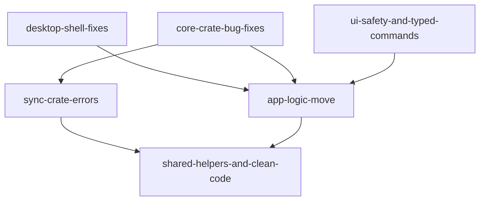

## Summary
An architecture review found about 11 real bugs (the close sync, parallel syncs, unescaped search snippets, lost `.markdown` notes, notes from another vault in the editor, hidden errors, empty uploads, link decoding, a weak MCP token, Russian text) and many design problems (locks, logic that only the window has, god modules, big error enums, boolean parameters, magic values).
The plan fixes the bugs first, each with a test that fails before the fix, while the code is still in its known shape. Then it refactors.
Order:
1. Three stories run at the same time, they touch different folders: `desktop-shell-fixes` (src-tauri bugs and locks), `core-crate-bug-fixes` (bugs in the crates), `ui-safety-and-typed-commands` (UI ticket helper, typed command map, Settings errors, shared `t()`).
2. `sync-crate-errors` (after the crate bugs) and `app-logic-move` (after the three first stories) run at the same time: one cleans `kknow-sync`, the other moves logic into `kknow-app` and splits the big modules.
3. `shared-helpers-and-clean-code` runs last because it touches all crates: atomic write helpers, `kknow-run` cleanup, renames and named constants.
Each story updates `ARCHITECTURE.md` / `site/architecture.md` for its part.

## desktop-shell-fixes: Fix the close sync, the sync guard and the locks in src-tauri

Depends on: nothing

Part of the epic "Fix the bugs and the design problems from the architecture review". This story covers the bugs and the lock problems inside `src-tauri` only.

## Bugs
1. `lib.rs`, `on_window_event`: run `sync_on_close` and set `CLOSING` only for the window with the label `main`. Closing Settings must do nothing for sync.
2. `updater.rs`, `restart_to_update`: reset `CLOSING` when the install fails.
3. `sync_status.rs`, `sync_on_close`: wait until the `CLOSE_WAIT` deadline (5 s), not until the first `TICK` with no finished sync.
4. `sync.rs`, `exchange`: add a single-flight guard to `VaultSlot` (for example an `AtomicBool` with an RAII guard). `sync_now`, the scheduler and `sync_on_close` must skip or return a "busy" code when a sync of the same vault already runs.
5. Write all `eprintln!`/`expect` messages in `lib.rs` and `sync_status.rs` in English.

## Locks
- `VaultSlot::read`/`write`: use an `RwLock` so search, MCP reads and `git status` do not block autosave. Run `git status` and `git diff` without holding the lock.
- `mcp_http.rs`, `configure`: take the server out of the lock, then `stop()` and `wait_until_free` without the lock.
- `commands.rs`, `list_vaults`: do not read `remote.json` for each vault on the main thread; keep the value in memory in the slot (refresh it when the remote changes) or make the command async.
- `settings.rs`, `put`: make the memory write and the disk save happen under one lock, so the last value always wins on disk.

Keep the window decision logic in small testable functions (for example `fn runs_close_sync(label: &str) -> bool`) so each bug has a unit test that fails before the fix.

Follow CLAUDE.md: no code comments, English outside the UI, UI strings in both locales. Run `cargo test --workspace`, `cargo clippy --workspace --all-targets -- -D warnings`.

### Acceptance
- Closing a non-main window does not run the last sync and does not set CLOSING; a test covers it
- A failed update install resets CLOSING; a test covers it
- sync_on_close waits up to CLOSE_WAIT; a test with a fake clock or short wait shows it
- Two parallel syncs of one vault: the second one is skipped or returns busy; a test covers it
- VaultSlot uses a read/write lock and git status/diff run without the lock
- mcp_http configure does not hold the lock while it stops the server
- list_vaults does not read remote.json on the main thread
- settings put cannot leave an older value on disk; a test covers it
- No Russian text in src-tauri non-UI messages
- cargo test --workspace and cargo clippy -D warnings pass

## core-crate-bug-fixes: Fix the bugs in kknow-core, kknow-index, kknow-sync and kknow-app

Depends on: nothing

Part of the epic "Fix the bugs and the design problems from the architecture review". This story fixes the bugs inside the crates. Each fix gets a test that fails before the fix.

1. **Search snippet HTML** (`crates/kknow-index/src/search.rs`): the fallback `shorten(&body)` when tantivy finds no fragment is not escaped, and `ui/src/palette.ts` puts `row.snippet` into `innerHTML`. Escape the fallback with the same escaping as the highlighted fragments. Test: a body with `` and no match fragment gives an escaped snippet.
2. **`.markdown`/`.mdown` notes** (`crates/kknow-core`): `rescan` accepts three extensions, but `NoteId::to_relative_path` and `Vault::path_for` always build `<id>.md`. Keep the real extension of each note (store it in the vault map from `rescan`) so `refresh`, `write`, `rename_folder` and sync use the real file. `rescan` must reject (report as a problem, keep one) two files with one ID, for example `a.md` and `a.markdown`. Document the choice in `ARCHITECTURE.md`.
3. **`proposal_reviewed`** (`crates/kknow-app/src/threads.rs`): `resolve_with_event(..).is_err()` must ignore only `UnknownComment` and `NotAnAgentComment`; any other error (IO, failed save) is returned and the thread is not marked done.
4. **Empty upload** (`crates/kknow-sync/src/engine.rs`): replace `outgoing.get(id).cloned().unwrap_or_default()` with `outgoing.remove(id)` and return an error when the note is missing.
5. **Percent-decoding** (`crates/kknow-index/src/parse.rs`, `decode_target`): decode `%XX` to bytes, then `String::from_utf8` (keep the raw target when it is not valid UTF-8). `[x](%D0%9F%D0%BB%D0%B0%D0%BD.md)` links to `План`.
6. **MCP token** (`crates/kknow-app/src/mcp.rs`): generate the token from `getrandom` (already a dependency), not from the `RandomState` seed.

Write new test data in English except where non-ASCII is the point of the test. Follow CLAUDE.md: no code comments, English outside the UI, UI strings in both locales. Run `cargo test --workspace`, `cargo clippy --workspace --all-targets -- -D warnings`. If a change is visible to users (extensions), update the site page about files in `site/reference/`.

### Acceptance
- Each of the six bugs has a test that fails before the fix and passes after
- The search fallback snippet is HTML-escaped
- A .markdown note keeps its file after write, refresh, rename_folder and sync; two files with one ID are reported by rescan
- proposal_reviewed returns IO and save errors
- Sync returns an error instead of uploading an empty note
- Percent-encoded UTF-8 link targets are decoded
- The MCP token comes from getrandom
- cargo test --workspace and cargo clippy -D warnings pass

## ui-safety-and-typed-commands: Add a vault-aware note ticket, a typed command map and Settings errors in the UI

Depends on: nothing

Part of the epic "Fix the bugs and the design problems from the architecture review". This story covers the UI items.

1. **Note ticket with the vault**: the "is this still the same note" check after an `await` compares only the note ID in about 24 places (`ui/src/window/note.ts`, `marks.ts`, `proposals-float.ts`, and others; find them with grep). Note IDs are unique only in one vault. Add one helper (for example `noteTicket()` / `ticket.isCurrent()`) that captures vault ID and note ID, as `ui/src/window/lock-view.ts` already does, and use it in all places. Add a unit test where a note with the same ID in another vault is opened during an `await` and the old result is dropped.
2. **Typed command map**: generate with the existing ts-rs bindings (`src-tauri/src/bindings.rs`, output `ui/src/bindings.ts`) a map from each Tauri command name to its argument and result types. Use it for `invoke` in `ui/src/api.ts` and for the mock `invoke` in `ui/src/mock/core.ts`, so a renamed command or argument fails `tsc` at build time. The bindings test must fail when the generated file is out of date, as it does now for types.
3. **Split the mock `invoke`** in `ui/src/mock/core.ts` into modules by domain (notes, vaults, sync, agents, ...) that use the typed map.
4. **Settings errors**: errors in the Settings window now go only to `console.error`. Show them in the window (reuse `ui/src/error-view.ts` or the core error text helpers); all text in `locales/ru.json` and `locales/en.json`.
5. **Shared `t()`**: `ui/e2e/window.ts` has its own copy of the `t()` lookup that already differs from `ui/src/i18n.ts`. Move the lookup into one module and import it from both.

No file in `ui/src` may be longer than the limit in `ui/tests/source-guards.test.ts`, and no exemption may be added. Follow CLAUDE.md: no code comments, English outside the UI, UI strings in both locales. Run `cargo test --workspace`, `cargo clippy --workspace --all-targets -- -D warnings`, `pnpm ui:test` and `pnpm ui:e2e`.

### Acceptance
- All note-identity checks after await use one helper that includes the vault ID; a test covers a same-ID note in another vault
- ui/src/api.ts and the mock invoke use a generated typed command map; a wrong command name or argument fails the type check
- The bindings test fails when the generated command map is stale
- Settings window shows errors to the user in both languages
- ui/e2e/window.ts and the app share one t() implementation
- No file in ui/src is longer than the source-guards limit and no exemption is added
- cargo test, clippy, pnpm ui:test and pnpm ui:e2e pass

## sync-crate-errors: Split the kknow-sync errors and keep SyncProvider to storage

Depends on: core-crate-bug-fixes

Part of the epic "Fix the bugs and the design problems from the architecture review". This story cleans up `crates/kknow-sync`.

1. Split `kknow_sync::Error` (about 38 variants) into separate error types for git, crypto and config (and storage if it helps), with a small top-level enum that wraps them. Callers in `kknow-app`, `kknow-cli` and `src-tauri` match on the new types; the codes the UI gets (see `ui/src/core-text.ts`/`sync-text.ts`) must stay the same or be updated in both locales.
2. Keep the `SyncProvider` trait to `get`/`put`/`delete`/`list`. Move the encryption check out of the trait into the encrypted layer or the engine.
3. Move locked notes and crypto out of `kknow-sync` into their own module boundary or crate if that makes the crates clearer; decide and write the reason in `ARCHITECTURE.md`. The core crates must not depend on Tauri.
4. Replace boolean parameters in this crate with enums or two functions: `Git::diff(.., staged)`, `Git::discard(.., staged)`, `ours(.., origin)`.
5. Update `ARCHITECTURE.md` and `site/architecture.md` with the new crate or module boundaries.

Follow CLAUDE.md: no code comments, English outside the UI, UI strings in both locales. Run `cargo test --workspace`, `cargo clippy --workspace --all-targets -- -D warnings`.

### Acceptance
- kknow_sync errors are split into git, crypto and config types
- SyncProvider has only get, put, delete and list
- Git::diff, Git::discard and ours have no boolean parameters
- Error codes sent to the UI are unchanged or updated in both locales
- ARCHITECTURE.md and site/architecture.md describe the boundaries
- cargo test --workspace and cargo clippy -D warnings pass

## app-logic-move: Move shared logic into kknow-app and split Workspace, the CLI main and commands.rs

Depends on: desktop-shell-fixes, core-crate-bug-fixes, ui-safety-and-typed-commands

Part of the epic "Fix the bugs and the design problems from the architecture review". The CLI must get the same behaviour as the window. Move this logic from `src-tauri` and `crates/kknow-cli` into `crates/kknow-app`, and make both frontends call it:

- agent answers on note open and the view of a locked note (`load_note`, `note_view`);
- link preview parsing (`link_preview`);
- vault lookup by ID or name and the label scope (`VaultRegistry::find`, `mcp.rs`, `mcp_http.rs`, `kknow-cli`);
- git client setup (`kknow-cli` and `src-tauri/src/git.rs`);
- proposal review "accept only these edits" and "reject all" (`kknow-cli`);
- JSON-RPC batch handling: move it from `mcp_http.rs` into `kknow-app` so stdio MCP handles batches too.

Then split the god modules:
- `Workspace` in `crates/kknow-app/src/lib.rs` (about 70 methods) into modules by domain (notes, folders, agents, proposals, ...);
- `crates/kknow-cli/src/main.rs` into a module per command group;
- `src-tauri/src/commands.rs` into a module per domain. Keep the generated typed command map (from the story `ui-safety-and-typed-commands`) valid.

Replace the `String` errors in the CLI (about 48 `.map_err(|e| e.to_string())`) with a typed CLI error, and replace `Error::BadProposal(String)` and `problem: Option<String>` with codes. Remove the dead `sync_preview` with `#[allow(dead_code)]`. Add tests in `kknow-app` for the moved logic, and a test that shows the CLI and the window path give the same result (for example the same vault lookup, the same note view of a locked note, a JSON-RPC batch over stdio). Update `ARCHITECTURE.md` and `site/architecture.md`, and `site/reference/` if a CLI command changes.

Follow CLAUDE.md: no code comments, English outside the UI, UI strings in both locales. Run `cargo test --workspace`, `cargo clippy --workspace --all-targets -- -D warnings`, `pnpm ui:test` and `pnpm ui:e2e`.

### Acceptance
- load_note/note_view, link_preview, vault lookup and label scope, git client setup, proposal accept-only/reject-all and JSON-RPC batch live in kknow-app and both frontends use them
- stdio MCP handles JSON-RPC batches; a test covers it
- Tests show the CLI and the window give the same result for the moved logic
- Workspace, kknow-cli main.rs and src-tauri commands.rs are split into modules
- The CLI has no .map_err(|e| e.to_string()); BadProposal and problem use codes
- sync_preview is removed
- ARCHITECTURE.md and site/architecture.md are updated
- cargo test, clippy, pnpm ui:test and pnpm ui:e2e pass

## shared-helpers-and-clean-code: Add the atomic write helper, clean kknow-run and fix the remaining clean code items

Depends on: sync-crate-errors, app-logic-move

Part of the epic "Fix the bugs and the design problems from the architecture review". This is the last story: it touches all crates, so it runs after the others.

1. **Helpers**: add one atomic write helper (write to a temp file, fsync, rename) and one "load or move aside as `.broken`" helper in the lowest crate that all users can depend on (likely `kknow-core`). Replace the copies in about 14 places across the crates and `src-tauri` (grep for `.tmp`, `rename(`, `.broken`). Test both helpers.
2. **kknow-run**: split `crates/kknow-run/src/lib.rs` into modules; replace `Outcome`/`Finished` (`timed_out` and `stopped` can be true together) with one enum of end states; let `kknow-app` give the note-aware defaults (the agent script, the Confluence command) to `Manifest::load` instead of `kknow-run` knowing about notes.
3. **kknow-index `parse()`**: split into small functions.
4. **Impossible states**: the empty `vault_id` in `Target` must not be possible (use `Option` or a separate type).
5. **Boolean parameters**: replace `store_as(.., locked)` and `render(.., fragment)` with enums or two functions (the git ones are done in `sync-crate-errors`; check the rest with grep).
6. **Magic values**: give names to search limits and boosts, sync and UI intervals, window sizes, and header names that the UI also uses (share the header names with the UI through the bindings or one constant file).
7. **Renames**: rename what needed a comment: `read` and `open_text`, `set_task` and `set_task_unlocked`, `Status::for_agent`, `ME`.
8. Update `ARCHITECTURE.md` and `site/architecture.md` with the final crate boundaries (helpers, kknow-run defaults).

Follow CLAUDE.md: no code comments, English outside the UI, UI strings in both locales. Run `cargo test --workspace`, `cargo clippy --workspace --all-targets -- -D warnings`, `pnpm ui:test` and `pnpm ui:e2e`.

### Acceptance
- One atomic write helper and one load-or-broken helper exist, have tests, and replace all copies
- kknow-run lib.rs is split; the run end state is one enum without impossible combinations
- Manifest::load gets note defaults from kknow-app
- parse() is split into small functions
- Target cannot have an empty vault_id
- store_as and render have no boolean parameters
- Named constants replace the listed magic values
- read/open_text, set_task/set_task_unlocked, Status::for_agent and ME are renamed
- ARCHITECTURE.md and site/architecture.md describe the final boundaries
- cargo test, clippy, pnpm ui:test and pnpm ui:e2e pass with no comments in the code
