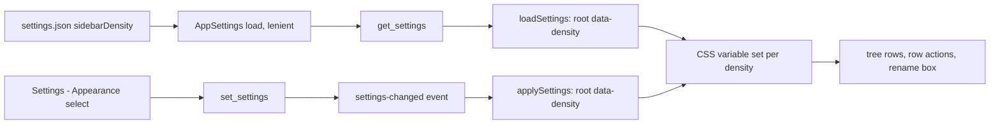

## Summary

**Problem**
- The rows of the sidebar note tree are tall (about 31 px) and the user cannot make them denser or looser: the spacing is fixed in the stylesheet, and themes accept only colors and fonts.

**Idea**
- A new global preference "Sidebar density" with three values: compact, normal (today's look) and comfortable. It is kept in the global settings file of the app, next to the theme and the note label.
- The stylesheet takes the row spacing from a few named spacing values. A marker on the page root picks one of three sets of these values, so the window changes the marker and all rows follow at once, with no restart.

**What the agent will do**
1. Add the density value to the global settings in `crates/kknow-app/src/settings.rs`; an unknown value in the file falls back to normal. Regenerate the TypeScript types of the UI.
2. Replace the fixed row, row action and rename-box spacing in `ui/src/styles.css` with spacing values, with one set per density.
3. Set the density marker on the page at startup and on each settings change in `ui/src/window/appearance.ts`.
4. Add a "Sidebar density" choice to Settings → Appearance (`ui/src/settings/appearance.ts`) with Russian and English texts, and support it in the browser mock.
5. Describe the setting on the documentation site and in `ARCHITECTURE.md` (why it is a user preference and not a theme value).

**Result**
- Before: tree rows are always about 31 px high. After: the user picks compact (about 24 px), normal (unchanged) or comfortable (taller) and sees the change at once, in every vault and every theme.

**No change**
- Themes: they still accept only colors and fonts. Vault settings, the CLI, the note panel on the right, the font size and the horizontal indents of the tree.

**Risks and assumptions**
- The issue points the docs to `site/features/side-panel.md`, but that page is about the right-hand note panel; the sidebar page is `site/features/vaults.md`, so the docs go there.
- In normal density the rename box gets 1 px more vertical padding, so that rename mode keeps the row height; all other normal spacing stays exactly as now.
- Exact pixel values for compact and comfortable are chosen by the agent (compact about 24 px, comfortable about 37 px).

## Goal

Let the user choose how dense the sidebar tree is, as a global preference that is the same in all vaults and with all themes, and keep today's look as the default.

## Current behavior

- `ui/src/styles.css`:
  - `.note-list button`: `font-size: 13px; padding: 7px 10px;` → row ≈ 31 px. This rule covers vault rows, folders, notes, the trash, trash entries and the Files list (`.files .file-list` is also a `.note-list`).
  - `.note-list .row-menu, .row-plus, .row-git`: `width: 26px; padding: 6px 4px;` with a 16 px icon → 28 px high.
  - `.tree-rename`: `padding: 5px 8px; border: 1px`. `renameInTree` (`ui/src/window/edits.ts`) hides the row button and the row actions and prepends this input, so in rename mode the row height is the input height, which is a few px less than the button.
  - `.note-list ul` indent `14px` and `.note-list button.note` `padding-left: 28px` define the horizontal layout.
- `AppSettings` (`crates/kknow-app/src/settings.rs`) has `note_label: NoteLabel` with `lenient_label`; there is no density field. `ui/src/bindings.ts` is generated from it (`KKNOW_BLESS=1 cargo test -p kknow-desktop bindings`).
- `ui/src/window/appearance.ts`: `loadSettings` applies settings at startup, `applySettings` on `settings-changed`; the theme sets `document.documentElement.dataset.theme`.
- `ui/src/settings/appearance.ts` has the Theme and "Notes in the list" (`noteLabel`) select rows.
- Themes (`crates/kknow-app/src/theme.rs`, `VARIABLES`) accept only colors and fonts and warn about other variables.

## Required behavior

- `settings.json` may hold `"sidebarDensity": "compact" | "normal" | "comfortable"`. Missing or unknown → `normal`. Saving the settings writes the field.
- The window root element carries `data-density="<value>"` from startup on, and the value follows each settings change at once.
- `normal` renders exactly the current paddings of rows and actions. `compact` gives rows of about 24 px, `comfortable` gives rows clearly taller than now. All tree rows (vaults, folders, notes, trash, trash entries, Files list) and the row actions follow the density.
- Rename mode keeps the row height in every density.
- Settings → Appearance shows a "Sidebar density" select after "Notes in the list", in both languages.

## Requirements

- R1. `AppSettings` has `sidebar_density: SidebarDensity`, serialized as `sidebarDensity`; `SidebarDensity` is an enum `Compact | Normal | Comfortable` with lowercase serde names, `Default = Normal`, and the `ts` derive like `NoteLabel`.
- R2. A lenient deserializer (like `lenient_label`) maps `"compact"` and `"comfortable"` to their values and any other string to `Normal`; a settings file with an unknown density loads without a load problem and keeps the other fields.
- R3. `AppSettings::default().sidebar_density == Normal`, and a file without the field loads as `Normal`.
- R4. A saved settings file contains `"sidebarDensity": "<value>"`, and loading it back gives the same value.
- R5. `ui/src/bindings.ts` is regenerated and has `SidebarDensity` and the `sidebarDensity` field; the bindings staleness test passes.
- R6. `ui/src/styles.css` defines density variables on `:root` (at least `--tree-row-y`, `--tree-action-y`, `--tree-rename-y`) with the normal values `7px`, `6px` and `6px`, and overrides them in `:root[data-density="compact"]` and `:root[data-density="comfortable"]`. The horizontal paddings, indents, font size and widths stay fixed.
- R7. `.note-list button` uses `padding: var(--tree-row-y) 10px`; the row actions use `padding: var(--tree-action-y) 4px`; `.tree-rename` uses `padding: var(--tree-rename-y) 8px`. Rules that override only `padding-left` keep working.
- R8. With `normal` (or no attribute) the computed padding of a tree row is `7px 10px` and of a row action `6px 4px`, the same as now.
- R9. With `compact` a note row is 22–26 px high and a row action is not taller than the row; with `comfortable` a note row is at least 35 px high.
- R10. In each density, the height of a vault row in rename mode differs from its normal height by at most 1 px. The `line-height` of `.note-list button` and `.tree-rename` is set to the same fixed value so that the button and the input have equal content height; `--tree-rename-y` equals `--tree-row-y` minus the 1 px border in each set.
- R11. `ui/src/window/appearance.ts` sets `document.documentElement.dataset.density` in `loadSettings` (before the first tree render) and in `applySettings` when the value changes; no reload happens.
- R12. `ui/src/settings/appearance.ts` adds a select row after "Notes in the list" with the options compact, normal, comfortable; a change calls `patch({ sidebarDensity })`.
- R13. The keys `settings.appearance.density`, `settings.appearance.density.detail`, `settings.appearance.density.compact`, `settings.appearance.density.normal`, `settings.appearance.density.comfortable` exist in both `locales/en.json` and `locales/ru.json`; no UI text is in the code.
- R14. The mock (`readSettings` in `ui/src/mock/store.ts`) has `sidebarDensity: "normal"` in its fallback, and the mock `set_settings` keeps and emits it, so `pnpm ui:mock` shows the change.
- R15. `VARIABLES` in `crates/kknow-app/src/theme.rs` is unchanged; a theme with `tree-row-y` still gets a warning.
- R16. Docs: `site/features/vaults.md` gets a "Row density" part; `site/reference/files.md` lists the density in the `settings.json` row; `ARCHITECTURE.md` (Appearance section, ~l.1377) describes `sidebarDensity` and why it is a global user preference and not a theme variable or a vault setting. `pnpm docs:build` passes.
- R17. No comments are added; `cargo test --workspace`, `cargo clippy --workspace --all-targets -- -D warnings`, `pnpm ui:test`, `pnpm ui:e2e` pass.

## Design

- Rust: add `SidebarDensity` and `lenient_density` next to `NoteLabel` in `settings.rs`; add the field with `#[serde(deserialize_with = "lenient_density")]` and set it in `Default`. Fix any struct literal of `AppSettings` in tests and in `src-tauri` that no longer compiles.
- CSS values (the agent may tune by ±1 px to hit R9/R10):

  | density | `--tree-row-y` | `--tree-action-y` | `--tree-rename-y` |
  |---|---|---|---|
  | compact | 3.5px | 4px | 2.5px |
  | normal | 7px | 6px | 6px |
  | comfortable | 10px | 9px | 9px |

  Line height: set `line-height: 17px` (the current computed content height of a 13 px row; the agent checks it in the mock so that normal rows stay 31 px) on `.note-list button` and `.tree-rename`.
- Window: a small function `applyDensity(value)` in `ui/src/window/appearance.ts` sets `document.documentElement.dataset.density`; `loadSettings` and `applySettings` call it.
- Settings page: same `row(..., select(...), detail)` pattern as `noteLabel`, cast to `SidebarDensity`.

## Tests

- Rust (`crates/kknow-app/src/settings.rs` tests):
  - default is `Normal`; a file without the field loads as `Normal`;
  - `{"locale":"en","sidebarDensity":"tiny"}` loads as `Normal` with no problem and `locale == "en"`;
  - `"compact"` and `"comfortable"` load as their values; a save writes `"sidebarDensity": "compact"` and a load round-trips.
- e2e (`ui/e2e/settings.spec.ts`), on the mock:
  - by default `html` has `data-density="normal"` and a note row in the tree has computed padding-top `7px` and height ≈ 31 px;
  - picking "compact" in Settings → Appearance sets `data-density="compact"` in the main window and the note row height is 22–26 px; picking "comfortable" gives ≥ 35 px; after a reload the value stays;
  - in compact, starting a vault rename keeps the vault row height within 1 px.
- `pnpm ui:test` (i18n key parity, no comments) passes with the new keys.

## Out of scope

- Theme spacing variables, per-vault density, a CLI command for the density.
- Density of other lists (palette, note panel, search results, settings rows).
- Changes of font size or horizontal indent of the tree.
