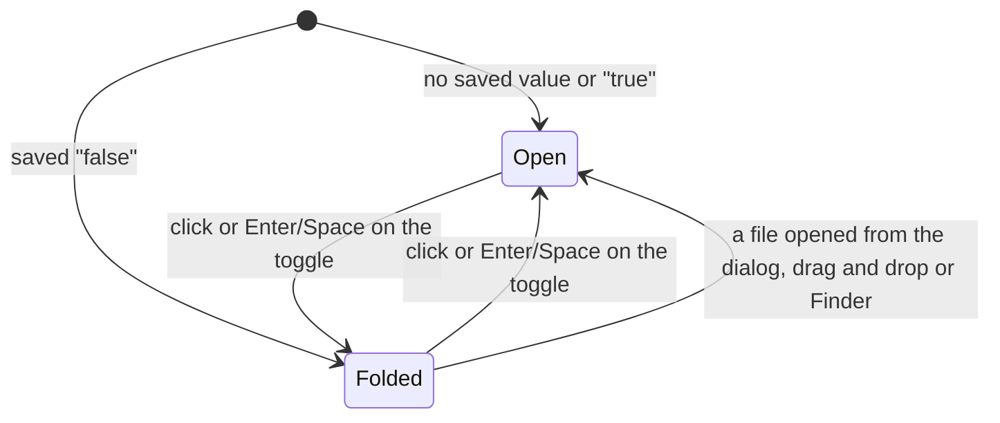

## Summary

**Problem**
- The **Files** list at the bottom of the sidebar (markdown files opened without a vault) is always open. It can take up to 40% of the sidebar height, and the user cannot hide it to give the vault tree more room.

**Idea**
- The section title becomes a fold button with an arrow, like the vault, folder and trash rows. A click hides the list, so only the title row stays at the bottom and the vault tree grows into the free space.
- The window remembers the choice in the browser storage of the window, as it already does for the trash. With no saved choice the list is open, so nothing changes for current users.
- When the user opens a new file, the list opens again, so the new row is visible. A count of files next to the title shows that a folded list is not empty.

**What the agent will do**
1. Change the Files header in `ui/src/window/dom.ts` into a fold button (arrow, title, count) next to the existing **Open file…** button.
2. Add the fold logic in `ui/src/window/files.ts`: read and save the choice, hide or show the list, update the count, and open the list when a file is opened from the dialog, by drag and drop or from Finder.
3. Add styles in `ui/src/styles.css` for the arrow and the folded section.
4. Add the button labels in English and Russian to `locales/en.json` and `locales/ru.json`.
5. Add browser tests in `ui/e2e/files.spec.ts` and describe the fold in `site/features/standalone-files.md`.

**Result**
- Before: the Files list is always open and takes space from the vault tree. After: one click folds it to one row, the tree takes the space, and the choice stays after a reload.

**No change**
- The Rust core, the CLI, the list of files on disk, the vault tree, the trash, and the note panel on the right (`site/features/side-panel.md` describes that panel, not the sidebar, so it does not change).

**Risks and assumptions**
- The count shows in both states when the list is not empty; this is the "list has content" sign for the folded state.
- When the window starts and restores the last open file, the saved fold choice wins: the list stays folded.
- Clicks on a file in the list, and back and forward navigation, do not change the fold state.

## Goal

The user can fold the **Files** section of the sidebar to its header row and open it again. The choice persists. The default look does not change.

## Current behavior

- `ui/src/window/dom.ts` renders `<section class="files" aria-labelledby="files-title">` with a `.sidebar-head` that holds `<span id="files-title" class="sidebar-title">` and the `#open-file` button, and then `<ul id="file-list" class="note-list file-list">`.
- `ui/src/styles.css`: `.files { flex: none; display: flex; flex-direction: column; max-height: 40%; border-top: ... }`. `#note-list` (`.note-list { flex: 1 }`) gets the rest of the height.
- `ui/src/window/files.ts`: `renderFiles()` fills `el.fileList` from `state.files`. `openPath(opened)` handles a file picked in the dialog (`pickFile` → `openFiles`), a dropped file (`takeDrop` → `adoptDropped` → `openFiles`) and a file from Finder or the command line (`takeOpened`). For `opened.kind === "file"` it calls `refreshFiles()` and `openFileView(path)`.
- The trash (`ui/src/window/trash.ts`) folds with a `button[aria-expanded]` that holds an `icon("chevron")` with class `chevron`, a title and a `.tree-count`, and saves the state in `localStorage` under `kknow:trash:open`.
- There is no way to fold the Files section.

## Required behavior

- The Files header has a toggle button with a chevron, the title "Files" and, when the list is not empty, the count of files.
- A click on the toggle (or Enter / Space while it has focus) folds or opens the list. `aria-expanded` follows the state. `aria-controls="file-list"`.
- Folded: `#file-list` is hidden; the section is only the header row, at the bottom of the sidebar; the vault tree takes the free height.
- The `#open-file` button stays in the header, outside the toggle, and works in both states.
- The state is saved in `localStorage` under `kknow:files:open` and read at start. A missing or unreadable value means open.
- Opening a standalone file through the dialog, drag and drop, Finder or a command-line argument opens a folded section, saves the open state, and the new row is shown as active.

## Requirements

- R1. The Files `.sidebar-head` contains `<button id="files-toggle">` with a chevron icon, the `#files-title` text and a `#files-count` element, and the `#open-file` button as a sibling of the toggle (not inside it). The section keeps `aria-labelledby="files-title"`.
- R2. `#files-toggle` has `aria-controls="file-list"` and `aria-expanded` equal to `"true"` when the list is open and `"false"` when folded.
- R3. A click on `#files-toggle` switches the state. When folded, `#file-list` has the `hidden` attribute and is not visible; when open, it is visible.
- R4. When folded, the section height equals its header row, and `#note-list` grows: its height is larger than in the open state with the same files.
- R5. The toggle `title` and `aria-label` come from new locale keys `sidebar.files.collapse` (open state) and `sidebar.files.expand` (folded state), present in both `locales/en.json` and `locales/ru.json`. No UI text in the code.
- R6. Each switch writes `kknow:files:open` = `"true"` or `"false"` to `localStorage`. Write errors are ignored (as in `aside.ts`).
- R7. At start, the state is folded only when `kknow:files:open` is `"false"`. Any other value, a missing value or a read error gives the open state.
- R8. `#files-count` shows the number of entries in `state.files` when it is greater than zero, and is hidden when the list is empty. It updates on each `renderFiles()`.
- R9. When `openPath` handles an opened file (`kind === "file"`), it opens a folded section and saves `"true"` before the file view opens. A file opened this way is visible in `#file-list` and has the `active` class.
- R10. Opening a vault note through `openPath`, a click on a list row, history navigation and the restore of the last file at start do not change the fold state.
- R11. `#open-file` opens the file dialog in both states.
- R12. The toggle works from the keyboard: focus on `#files-toggle` and Enter or Space switch the state (native button behavior).
- R13. The chevron rotates like the trash chevron: `#files-toggle[aria-expanded="true"] .chevron` uses the same rotation as `.note-list button.trash[aria-expanded="true"] .chevron`.
- R14. `site/features/standalone-files.md` describes the fold, the saved choice, the count and the automatic open on a new file. No code comments are added.

## Design

DOM (`ui/src/window/dom.ts`), inside `section.files`:

```html
<div class="sidebar-head files-head">
  <button id="files-toggle" class="files-toggle" aria-controls="file-list" aria-expanded="true">
    ${chevron icon with class "chevron"}
    <span id="files-title" class="sidebar-title">${t("sidebar.files")}</span>
    <span id="files-count" class="tree-count" hidden></span>
  </button>
  <button id="open-file" ...unchanged...></button>
</div>
<ul id="file-list" class="note-list file-list"></ul>
```

Add `filesToggle` and `filesCount` to `el` in `dom.ts`. Use the existing `iconMarkup("chevron")` and add the `chevron` class (or a wrapper with it) so that the shared chevron styles apply.

Logic (`ui/src/window/files.ts`):

- `const FILES_OPEN = "kknow:files:open"`; `let filesOpen = readFilesOpen()` with a guarded `localStorage.getItem` (`!== "false"`).
- `applyFilesOpen()`: sets `el.fileList.hidden = !filesOpen`, `aria-expanded`, `title`/`aria-label` from `sidebar.files.collapse` / `sidebar.files.expand`, and `data-open` on the section.
- `setFilesOpen(open: boolean)`: sets the state, writes the key in a `try`, calls `applyFilesOpen()`.
- `initFiles()` sets `el.filesToggle.onclick = () => setFilesOpen(!filesOpen)` and calls `applyFilesOpen()`.
- `renderFiles()` also updates `#files-count` (text and `hidden`).
- `openPath`: in the file branch, call `setFilesOpen(true)` before `refreshFiles()` / `openFileView()`.

Styles (`ui/src/styles.css`):

- `.files-toggle`: a bare flex button that fills the title space (`flex: 1`, no background or border, inherits font, `gap`, `cursor: pointer`, focus-visible outline as the other sidebar buttons). `.files-toggle .sidebar-title` keeps its look.
- `.files-toggle .chevron` and `.files-toggle[aria-expanded="true"] .chevron` mirror the trash chevron rules.
- `.file-list[hidden] { display: none; }`; the section keeps `max-height: 40%`, so when folded its height is the header only, and `#note-list` (`flex: 1`) takes the rest.

Locales: `sidebar.files.expand` = "Expand the Files list" / "Развернуть список файлов"; `sidebar.files.collapse` = "Collapse the Files list" / "Свернуть список файлов".



## Tests

E2E in `ui/e2e/files.spec.ts` (mock stubs, `pnpm ui:e2e`):

- T1 (R2, R3, R6, R7). Click `#files-toggle`: `aria-expanded="false"`, `#file-list` hidden. `page.reload()`: still folded. Click again: `aria-expanded="true"`, the README row visible. Reload: still open.
- T2 (R7). With a fresh page, `#files-toggle` has `aria-expanded="true"` and `#file-list` is visible.
- T3 (R4). The bounding box height of `#note-list` is larger in the folded state than in the open state.
- T4 (R9, R11). Fold the section, click `#open-file`, accept the dialog with `/Users/me/Desktop/draft.md`: the section opens and the draft row has the `active` class.
- T5 (R12). Focus `#files-toggle`, press Enter: folded; press Space: open.
- T6 (R8). `#files-count` shows the count of rows in `#file-list` and stays visible when folded.
- T7 (R5). The toggle `title` equals `t("sidebar.files.collapse")` when open and `t("sidebar.files.expand")` when folded.

Checks: `cargo test --workspace`, `cargo clippy --workspace --all-targets -- -D warnings`, `pnpm ui:test` (comment guard and locale checks), `pnpm ui:e2e`, `pnpm docs:build`.

## Out of scope

- Folding of other sidebar parts or a "collapse all" that includes Files.
- A resizable splitter between the vault tree and the Files section.
- Changes in the Rust core, the CLI, `files.json` or the mock data.
- `site/features/side-panel.md`: it describes the note panel on the right, not the sidebar.
