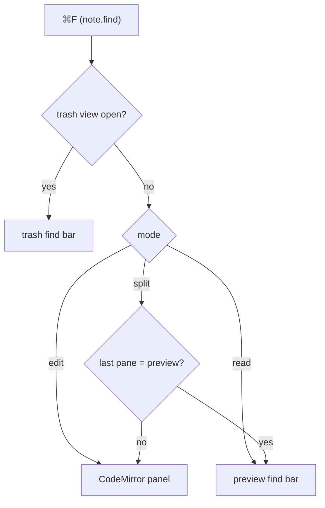

## Summary

**Problem**
- ⌘F ("Find in note") works only in the text editor. In Read mode the search panel opens inside the hidden editor, so the user sees nothing; in Side by side mode the rendered half never shows the matches. The read-only trash view has no search at all.

**Idea**
- A small find bar of its own works over the rendered text. It walks the visible text, asks the browser to paint all matches and the current match (a browser feature that colours text ranges without changing the page), and scrolls the current match into view.
- ⌘F picks the bar or the editor panel by the visible pane. When the mode changes, the query moves to the pane that is now visible. When the rendered text changes, the bar finds the matches again.

**What the agent will do**
1. Add a new module `ui/src/preview-find.ts`: the match search (pure, unit-tested), the bar with the same controls as the editor panel (no replace), and the highlighting, with a fallback that wraps matches in marked tags if the browser lacks the feature.
2. Change the ⌘F handler in `ui/src/window/keys.ts` and the mode switch in `ui/src/window/note.ts`, so ⌘F opens the right search and an open search follows a mode change.
3. Add small search helpers to the editor wrapper in `ui/src/editor.ts`, so the query can pass between the editor panel and the bar.
4. Attach the same bar to the trash view in `ui/src/window/trash.ts`.
5. Add the new UI strings to both locale files, the styles to `ui/src/styles.css`, unit and browser smoke tests, and update the docs pages for the editor and the shortcuts.

**Result**
- Read mode: ⌘F does nothing visible → a find bar opens and highlights every match in the rendered note.
- Side by side: only the source is searched → the pane with the focus is searched (the editor by default).
- Trash view: no search → the same find bar.

**No change**
- Live preview mode search and replace; the Rust core, the CLI and the shortcut settings (⌘F keeps the same action).

**Risks and assumptions**
- The rendered text and the source differ, so the "current match" kept across a mode change is the one with the same position number, or the first one.
- Older macOS WebKit may lack the painting feature; the fallback with marked tags covers it.
- Matches are not found across two separate paragraphs or cells, and not inside diagrams drawn as images.

## Goal

Search in the open note works in every view mode (Live preview, Side by side, Read) and in the trash view, with the same controls as the editor search, except replace.

## Current behavior

- `ui/src/window/keys.ts` binds `note.find` to `editor.openSearch()`; `ui/src/editor.ts` `openSearch()` calls `openSearchPanel(this.view)` from `@codemirror/search`.
- Mode names in code: `edit` = Live preview, `split` = Side by side, `read` = Read (`ui/src/note-mode.ts`). In `read`, `#app[data-mode="read"] .editor` is `display: none` (`ui/src/styles.css`), so the panel is invisible.
- `#preview` (`ui/src/window/dom.ts`) is filled by `showPreview(html)` in `ui/src/window/note.ts` (`innerHTML`, then task boxes, bookmarks, code blocks, copy buttons, images, async `renderDiagrams`). Embeds may load later.
- `#trash-view-body` is filled in `ui/src/window/trash.ts` and emptied by `closeTrashView()`; `Esc` on the document closes the trash view (`keys.ts`).
- The `editor.search.*` keys exist in `locales/en.json` and `locales/ru.json`.
- Playwright has `chromium` (`pnpm ui:e2e`) and `webkit` (`pnpm ui:e2e:webkit`) projects on the mock.

## Required behavior

- `edit`: unchanged — ⌘F opens the CodeMirror panel.
- `read`: ⌘F opens the preview find bar at the top of the preview pane and focuses its query field.
- `split`: ⌘F opens the bar of the pane that was last focused or clicked; the editor by default (also after a note opens).
- Trash view open: ⌘F opens the bar in the trash view, whatever the mode.
- Bar: query field, previous / next buttons, match case, by word, regexp toggles, counter "n of m" or "No matches", close button. `Enter` / ⌘G = next, `⇧Enter` / ⌘⇧G = previous, `Esc` = close (only the bar; a second `Esc` closes the trash view as now). Navigation wraps around. Non-empty selected text inside the pane becomes the query on open.
- All matches get one highlight, the current match a stronger one, and it scrolls into view (`block: "center"`, only when outside the visible area).
- Mode change with a search open: the query and options move to the search of the visible pane (`edit`→ editor panel, `read`→ bar; to `split` the open one stays). The current match is the one with the same ordinal number if it exists, else the first.
- Re-render of the container while the bar is open: matches are found again, the bar stays open, the current ordinal is kept if possible.
- Close: all highlights are removed, the DOM of the pane is the same as before opening.

## Requirements

- R1. In `read` mode ⌘F shows a visible find bar in the preview pane with focus in the query field.
- R2. Typing a query highlights all matches in the rendered text of `#preview`; the counter shows "1 of m"; with no match it shows "No matches"; an invalid regexp shows "No matches" and marks the field invalid (`aria-invalid="true"`).
- R3. Next / previous (buttons, `Enter`, `⇧Enter`, ⌘G, ⌘⇧G) move the current match with wrap-around, update the counter and scroll the current match into view.
- R4. Match case, by word and regexp change the matches the same way as in the editor search: case-insensitive by default; "by word" requires non-word characters or text edges on both sides; regexp uses JavaScript `RegExp` with the `u` flag (and `i` without match case); empty regexp matches are skipped.
- R5. Matches are found inside headings, lists, tables, callouts and code blocks, and may span inline elements (bold, links, inline code) inside one block; text from two different block elements is not joined into one match. Text in `button`, `input`, `svg`, `script`, `style` and `[aria-hidden="true"]` is not searched.
- R6. Closing the bar (`Esc`, close button) removes all highlights; after close the `innerHTML` of the pane equals the value before opening, and links and task checkboxes in the preview still work.
- R7. Highlights use the CSS Custom Highlight API (`CSS.highlights`) when it exists; otherwise matches are wrapped in `<mark class="find-match">` (current: `find-match find-current`), and the marks are removed and the text nodes normalized on close and before each re-search.
- R8. In `split` mode ⌘F opens the editor panel by default and the preview bar when the preview pane was focused or clicked last; non-empty selected text in the preview also selects the preview.
- R9. In `edit` mode ⌘F behaves as before (CodeMirror panel, replace available).
- R10. Changing the mode with a search open moves query, options and ordinal of the current match to the search of the visible pane; a closed search stays closed.
- R11. When the preview re-renders (new HTML, diagrams, embeds) with the bar open, matches update within one animation frame and the bar stays open.
- R12. With the trash view open, ⌘F opens the same bar in the trash view over `#trash-view-body`; `Esc` first closes the bar, then the trash view. Closing the trash view closes its bar.
- R13. All new strings exist in `locales/en.json` and `locales/ru.json`; existing `editor.search.*` keys are reused for button titles and labels; no UI text in code.
- R14. The feature works in `pnpm ui:mock`, in Chromium and in Playwright WebKit.
- R15. `site/features/editor.md` ("Find in the note") and the ⌘F row of `site/reference/shortcuts.md` say that search works in every mode and in the trash view, replace only in the editor.
- R16. `cargo test --workspace`, `cargo clippy --workspace --all-targets -- -D warnings`, `pnpm ui:test`, `pnpm ui:e2e`, `pnpm ui:e2e:webkit` (find spec at least) and `pnpm docs:build` pass; no code comments.

## Design

**`ui/src/preview-find.ts`** (new):
- Pure part, no DOM: `type FindQuery = { text: string; caseSensitive: boolean; wholeWord: boolean; regexp: boolean }` and `findRanges(blocks: string[], query): { block: number; from: number; to: number }[]` (or one string with block separators that never match). Invalid regexp → `null` (shown as invalid). Unit-tested with `node --test` in `ui/tests/preview-find.test.ts`.
- DOM part: collect text nodes with a `TreeWalker`, skipping the excluded elements (R5); group them by nearest block ancestor (`p, li, td, th, h1–h6, pre, blockquote, div`…); map offsets back to `(node, offset)` and build `Range`s.
- Paint: if `"highlights" in CSS`, set `CSS.highlights` entries `preview-find` and `preview-find-current` (`new Highlight(...ranges)`); styles `::highlight(preview-find)` / `::highlight(preview-find-current)` with the same colours as `.cm-searchMatch` / `.cm-searchMatch-selected`. Else the `<mark>` fallback (R7). Only one bar paints at a time (the trash bar and the preview bar never are visible together; the open one owns the highlight names).
- Scroll: `range.getBoundingClientRect()` vs the scroller; for marks `scrollIntoView({ block: "center" })`.
- `class PreviewFind` with `constructor(host: HTMLElement, body: HTMLElement)`, `open(query?: FindQuery, ordinal?: number)`, `close()`, `isOpen()`, `state(): { query: FindQuery; ordinal: number }`, `next()`, `previous()`. The bar DOM is built in TS with `t(...)` strings, inserted at the top of the host (sticky). Its input `keydown` handles `Enter`, `⇧Enter`, `Esc` (with `preventDefault` + `stopPropagation`, so the document handler in `keys.ts` does not also close the trash view). ⌘G / ⌘⇧G handled while the bar is open.
- A `MutationObserver` on `body` (childList, subtree, characterData) re-searches in `requestAnimationFrame` while open; in the fallback mode it is disconnected while marks are added or removed.

**`ui/src/editor.ts`**: add `searchState(): { query: FindQuery; open: boolean }` (via `getSearchQuery`, `searchPanelOpen`), `openSearch(query?: FindQuery)` (`setSearchQuery` then `openSearchPanel`), `closeSearch()` (`closeSearchPanel`). Ordinal transfer to the editor: select the n-th match via `findNext` repeated or by computing with `SearchQuery.getCursor`; else the first.

**`ui/src/window/`**: create `previewFind` (host `.preview-pane`, body `#preview`) and `trashFind` (host `#trash-view`, body `#trash-view-body`) in a small `find.ts` that exports `openFind()` and `followMode(prev, next)`. Track the last pane in `split` with `pointerdown`/`focusin` listeners on the editor and the preview pane; reset to editor on `openNote`. `keys.ts`: `note.find` → `openFind()`. `note.ts` `setMode`: call `followMode`. `trash.ts` `closeTrashView`: close `trashFind`. Re-render needs no extra call (observer).

**i18n** (new keys, en / ru): `find.count` "{{current}} of {{total}}" / "{{current}} из {{total}}", `find.none` "No matches" / "Нет совпадений", `find.bar` "Find in the rendered note" / "Поиск в просмотре" (aria-label). Reuse `editor.search.find` (placeholder), `next`, `previous`, `matchCase`, `byWord`, `regexp`, `close`.

**Docs**: `site/features/editor.md`, `site/reference/shortcuts.md`; add a short "Find in the preview" reason in `ARCHITECTURE.md` (Highlight API so the preview DOM and its listeners stay intact; marks only as fallback; observer because the preview is filled asynchronously).

## Tests

- Unit (`ui/tests/preview-find.test.ts`): plain, case-sensitive, whole word, regexp, invalid regexp, empty regexp match skipped, no match across blocks, match across inline pieces of one block, Cyrillic text.
- e2e (`ui/e2e/find.spec.ts`, mock data), run in Chromium and WebKit:
  - Read mode: ⌘F shows the bar; typing a word present in the mock note shows "1 of m" (m ≥ 2); `Enter` moves to "2 of m"; `Esc` hides the bar and the `#preview` HTML equals the HTML before opening; a task checkbox still toggles.
  - Side by side: ⌘F after a click in the editor opens `.cm-search`; after a click in `#preview` opens the preview bar.
  - Mode change: open the bar in Read, switch to Live preview → `.cm-search` is open with the same query.
  - Live preview: ⌘F opens `.cm-search` with the replace field (unchanged).
  - Trash view: open a trashed note, ⌘F shows the bar over `#trash-view-body`, first `Esc` closes the bar, second closes the trash view.
- Existing checks: R16.

## Out of scope

- Replace in the preview or the trash view.
- Search across notes (⌘K palette) and in the changes (git) view and hover popups.
- Matches inside rendered diagram SVGs and across block elements.
- Mapping a preview match to the exact source position (the ordinal is used).
