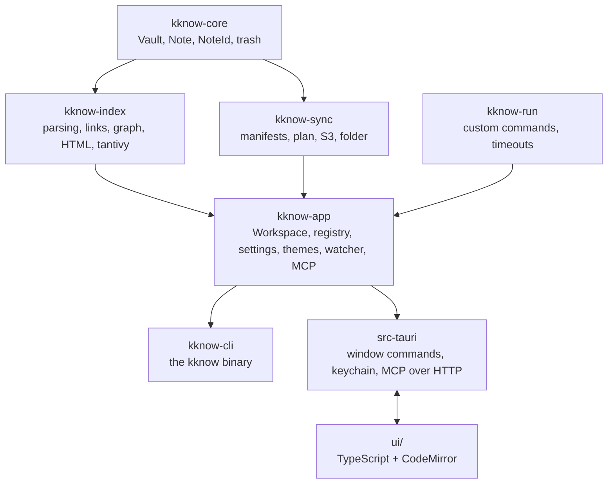
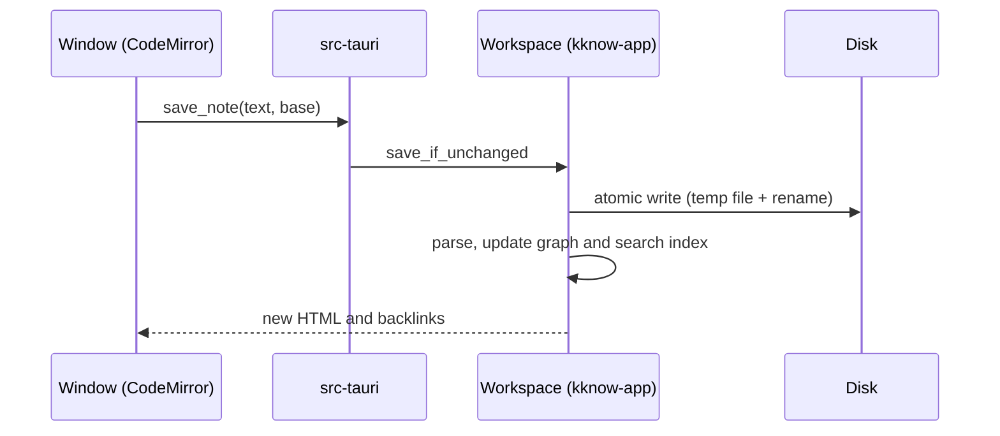
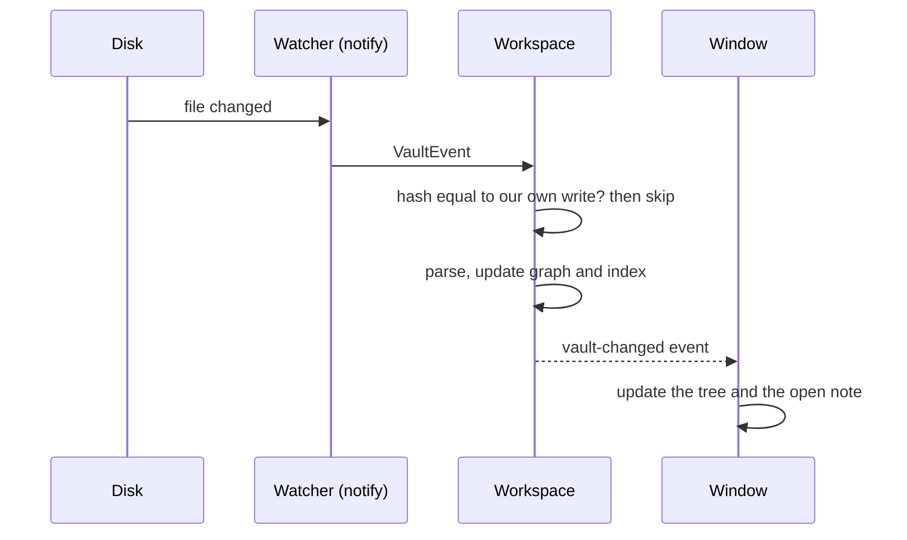
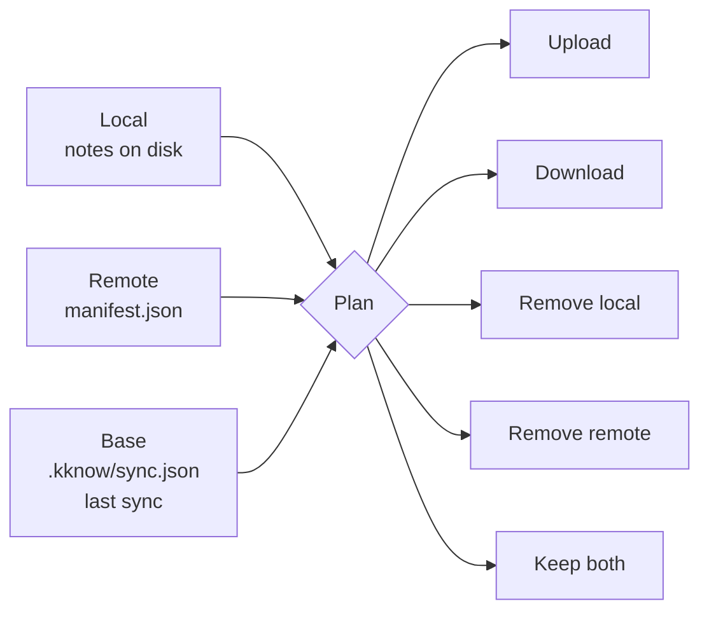

# Architecture

This page is a short tour of how kknow works inside. For the full design notes
and the reasons for each decision, read
[ARCHITECTURE.md](https://github.com/akuchin/kknow/blob/main/ARCHITECTURE.md)
in the repository.

## Three principles

1. **Files are the source of truth.** The link graph, the search index and the
   sync state are a cache. If you remove the cache, you lose no data.
2. **The core knows nothing about the UI.** No crate in `crates/` depends on
   Tauri. The window and the CLI are two equal frontends of one core.
3. **Sync is a plugin behind a trait.** S3 is one implementation of
   `SyncProvider`. A new storage must not need a change in the algorithm.

## Stack

| Task | Tool | Why |
|---|---|---|
| Desktop shell | [Tauri 2](https://tauri.app) | small binary, Rust core, system webview |
| Editor | [CodeMirror 6](https://codemirror.net) | mature and extensible |
| Markdown | [pulldown-cmark](https://github.com/pulldown-cmark/pulldown-cmark) | fast CommonMark with a pull API |
| Search | [tantivy](https://github.com/quickwit-oss/tantivy) | "Lucene in Rust", queries in milliseconds |
| File watching | `notify` + `notify-debouncer-full` | cross-platform |
| Sync storage | [opendal](https://opendal.apache.org) | one API for S3, MinIO and R2 |
| Frontend | TypeScript + Vite, no framework | a thin UI; the logic is in Rust |

## Crates



Dependencies go in one direction only. Each crate knows as little as possible:

- `kknow-core` knows nothing about text parsing.
- `kknow-index` knows nothing about the disk.
- `kknow-run` does not depend even on `core`. A module that runs external
  programs gets a target that is ready to use.
- `kknow-app` knows nothing about how the window shows the data.

Thus search and file watching came to the CLI and to the window at the same
time.

## Data flow

### You save a note



The save sends `base`, the text at the start of the edit. If the file on disk
is not `base`, someone else changed it. Then kknow writes the window text as a
conflict copy and does not touch the file.

### Another program changes a note



kknow identifies its own writes by the content hash. Without this, the window
would load a note again while you type in it.

## Parsing and links

- A `NoteId` is a path from the vault root without `.md`. It refuses `..` and
  absolute paths.
- pulldown-cmark parses the Markdown. `[[wiki links]]` are not CommonMark, so
  kknow finds them in the raw text. The parser gives the ranges of code and
  math, and the scanner skips them.
- Before rendering, kknow changes wiki links and tags to usual links with the
  `kknow://` scheme. The window catches clicks on them.
- The renderer removes raw HTML. A note from another vault must not run a
  script with the app's privileges.
- A rename rewrites only the links that would break or find a different note.
  It uses the parser spans, so links in code stay.

## Search

`SearchIndex` uses tantivy and indexes the text, the title, the tags and the
path, with a Russian stemmer. Each open vault has its own index in memory.

- kknow searches the last word also as a prefix with a regular expression.
  `word*` does not work in tantivy, because the tokenizer drops the asterisk.
- `search_all` asks all vaults at the same time. The score of one index cannot
  be compared with another index, so the results follow the vault order.

## Sync

The storage has the notes (`notes/<id>.md`) and a manifest (`manifest.json`).
A manifest is a list of notes with their content hashes. It has no
modification times: computer clocks drift, and S3 sets its own upload time.

kknow compares three manifests:



The base manifest does most of the work. Without it, a delete on one device
looks the same as a new note on another, and the deleted note would come back
again and again.

The sync runs in three steps, so you can save notes during a sync:

1. **Stage** — under the vault lock: make the plan, read the outgoing notes.
2. **Transfer** — without the lock: the network operations.
3. **Commit** — under the lock again: write the incoming notes. A remote delete
   moves the note to the trash.

kknow uploads the notes before the manifest. Before it writes the manifest, it
confirms that the remote manifest did not change since the start. Thus two
devices that sync at the same time do not remove each other's entries.

`SyncProvider` has four synchronous operations on bytes: `get`, `put`,
`delete` and `list`. Only the S3 implementation needs `tokio`, behind a cargo
feature. The tests run the same algorithm on storage in memory and on a
folder.

## MCP server

The protocol is in `kknow-app::mcp`, without a transport. It takes one JSON-RPC
2.0 message and returns the reply. Two transports carry it:

- **the app**: HTTP on `127.0.0.1` with a bearer token, on `tiny_http`. It uses
  the same open vaults and indexes as the window;
- **the CLI**: `kknow mcp` on stdin and stdout.

The protocol is written by hand on `serde_json`. It needs only four methods,
and an SDK would bring an async runtime into the window.

The server has no tool that writes note text. A wrong write loses a person's
work, and an agent with file access can edit the file itself.

## Custom commands

`kknow-run` reads `commands.json`, selects the commands for a target and runs
them through a `Runner` trait for each interpreter. The target path goes to the
script as an environment variable, never in the script text. kknow stops the
command and all its child processes after the timeout.

## The window

The UI is plain TypeScript, without a framework. A reactivity layer would take
attention from Rust, and Rust is the purpose of the project.

The main window code is in `ui/src/window/`, one module for each zone: the
tree, the note, the palette, the status bar, sync and others. The modules make
layers, and a module imports only from lower layers. The values that many zones
read are in one store with plain events.

The app has two windows: the main window and the settings. Both read
`settings.json` and get each change as an event. kknow does not use
`localStorage`, because each window has its own browser storage.

## Where the data is

```text
<vault>/
  *.md                     your notes
  attachments/             pasted and dropped images
  .kknow/
    sync.json              the snapshot of the last sync
    remote.json            the storage address and the conflict policy
    bookmarks.json         bookmarks
    themes/*.json          vault themes
    trash/<entry>/…        deleted notes and folders

<app config directory>/
  vaults.json              the vault list
  settings.json            app settings
  keybindings.json         changed shortcuts
  commands.json            custom commands
  files.json               standalone files
  mcp.json                 MCP server: on/off, port, token
  themes/*.json            shared themes
```

See [Files and folders](/reference/files) for the paths on each platform.
