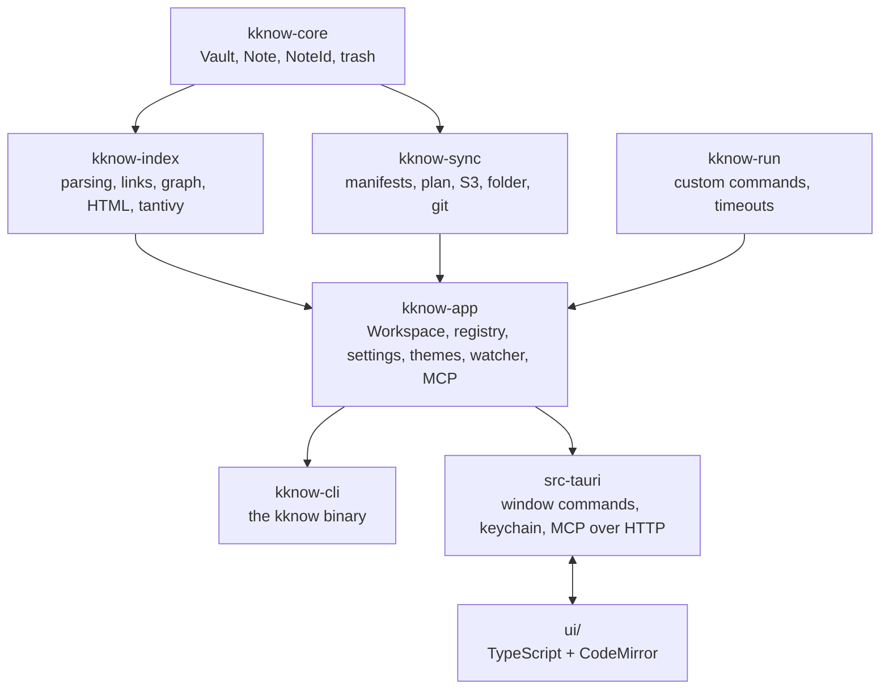
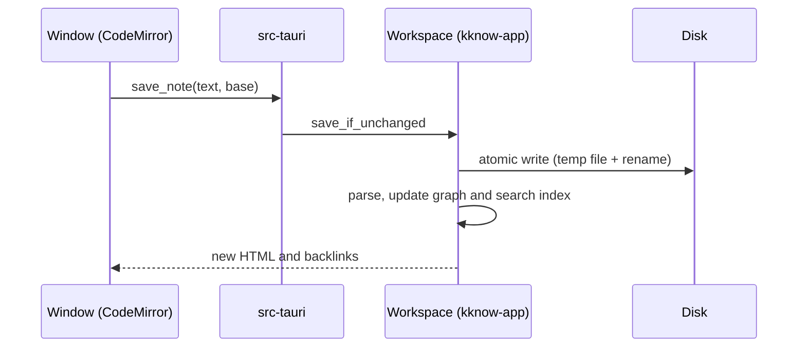
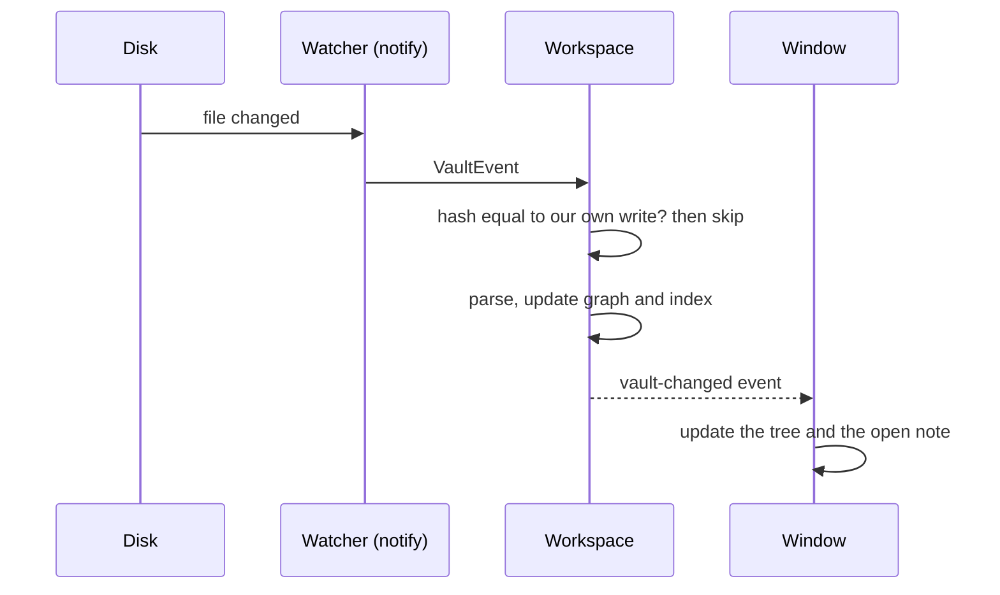
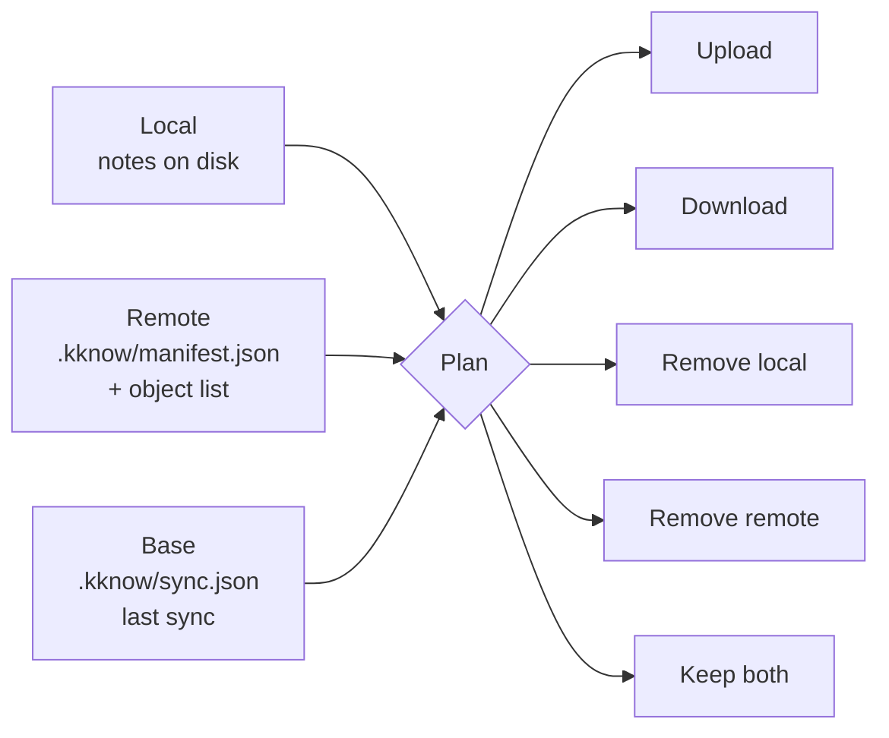
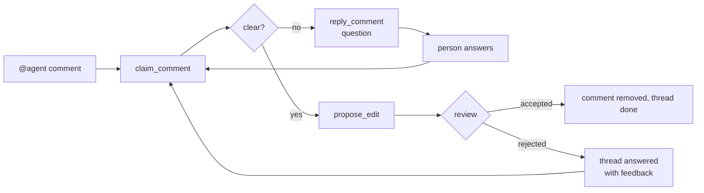

# Architecture

This page is a short tour of how kknow works inside. For the full design notes
and the reasons for each decision, read
[ARCHITECTURE.md](https://github.com/akuchin/kknow/blob/main/ARCHITECTURE.md)
in the repository.

## Three principles

1. **Files are the source of truth.** The link graph, the search index and the
   sync state are a cache. If you remove the cache, you lose no data.
2. **The core knows nothing about the UI.** No crate in `crates/` depends on
   Tauri. The window and the CLI are two equal frontends of one core.
3. **Sync is a plugin behind a trait.** S3 is one implementation of
   `SyncProvider`. A new storage must not need a change in the algorithm.

## Stack

| Task | Tool | Why |
|---|---|---|
| Desktop shell | [Tauri 2](https://tauri.app) | small binary, Rust core, system webview |
| Editor | [CodeMirror 6](https://codemirror.net) | mature and extensible |
| Markdown | [pulldown-cmark](https://github.com/pulldown-cmark/pulldown-cmark) | fast CommonMark with a pull API |
| Search | [tantivy](https://github.com/quickwit-oss/tantivy) | "Lucene in Rust", queries in milliseconds |
| File watching | `notify` + `notify-debouncer-full` | cross-platform |
| Sync storage | [opendal](https://opendal.apache.org) | one API for S3, MinIO and R2 |
| Frontend | TypeScript + Vite, no framework | a thin UI; the logic is in Rust |

## Crates



Dependencies go in one direction only. Each crate knows as little as possible:

- `kknow-core` knows nothing about text parsing.
- `kknow-index` knows nothing about the disk.
- `kknow-run` does not depend even on `core`. A module that runs external
  programs gets a target that is ready to use.
- `kknow-app` knows nothing about how the window shows the data.

Thus search and file watching came to the CLI and to the window at the same
time.

## Data flow

### You save a note



The save sends `base`, the text at the start of the edit. If the file on disk
is not `base`, someone else changed it. Then kknow writes the window text as a
conflict copy and does not touch the file.

### Another program changes a note



kknow identifies its own writes by the content hash. Without this, the window
would load a note again while you type in it.

### The note panel asks for links

The save answer has the backlink count, not the lines of the links. The lines
need a read of each source note, and a save comes after each pause in typing.
So the [note panel](/features/side-panel) asks for them on its own:

- `note_backlinks` when a different note opens, or after `vault-changed`;
- `unlinked_mentions` only while its section is open. The search index gives
  the notes that can have the name, and a text check finds the exact places.

## Parsing and links

- A `NoteId` is a path from the vault root without `.md`. It refuses `..` and
  absolute paths.
- pulldown-cmark parses the Markdown. `[[wiki links]]` are not CommonMark, so
  kknow finds them in the raw text. The parser gives the ranges of code and
  math, and the scanner skips them.
- Before rendering, kknow changes wiki links and tags to usual links with the
  `kknow://` scheme. The window catches clicks on them.
- The parser keeps the line of each heading and finds block IDs (`^id` at a
  line end). The `link_target` command uses them: the editor asks it where a
  link leads and which headings and blocks the note has.
- The renderer removes raw HTML. A note from another vault must not run a
  script with the app's privileges.
- A rename rewrites only the links that would break or find a different note.
  It uses the parser spans, so links in code stay.

## Search

`SearchIndex` uses tantivy and indexes the text, the title, the tags and the
path, with a Russian stemmer. Each open vault has its own index in memory.

- kknow searches the last word also as a prefix with a regular expression.
  `word*` does not work in tantivy, because the tokenizer drops the asterisk.
- `search_all` asks all vaults at the same time. The score of one index cannot
  be compared with another index, so the results follow the vault order.

## Sync

The storage is a mirror of the vault: each note is at its own path (`<id>.md`),
and the manifest is in `.kknow/manifest.json`. A manifest is a list of notes
with their content hashes. Before the plan, kknow adds to the remote manifest
the `.md` objects that it does not list (files of other programs) and removes
the entries with no object. It has no
modification times: computer clocks drift, and S3 sets its own upload time.

kknow compares three manifests:



The base manifest does most of the work. Without it, a delete on one device
looks the same as a new note on another, and the deleted note would come back
again and again.

The sync runs in three steps, so you can save notes during a sync:

1. **Stage** — under the vault lock: make the plan, read the outgoing notes.
2. **Transfer** — without the lock: the network operations.
3. **Commit** — under the lock again: write the incoming notes. A remote delete
   moves the note to the trash.

kknow uploads the notes before the manifest. Before it writes the manifest, it
confirms that the remote manifest did not change since the start. Thus two
devices that sync at the same time do not remove each other's entries.

Some files of `.kknow` sync with the notes: `bookmarks.json`,
`threads/*.json` and `proposals/*.json` (`kknow_sync::shared`, a closed list).
The manifest keeps them in a separate `files` map, with the same three-way
rules. A conflict in such a file is not a copy: the engine calls a merge
function from `kknow_app::merge`, which knows each format. Bookmarks become a
union, thread messages a union in time order, and a decision on a proposed
edit wins over "waiting". Git uses the same function on a merge conflict.

`SyncProvider` has four synchronous operations on bytes: `get`, `put`,
`delete` and `list`. Only the S3 implementation needs `tokio`, behind a cargo
feature. The tests run the same algorithm on storage in memory and on a
folder.

### Encryption

`Encrypted<P>` is a `SyncProvider` on top of another one. The engine sees
logical keys and plain bytes; the wrapper keeps encrypted names and bytes
(`kknow_sync::crypto`):

- a random data key, wrapped in `.kknow/key.json` by Argon2id from the
  passphrase and by the recovery code;
- objects: `"KKE1" | nonce | XChaCha20-Poly1305(length | data | padding)`,
  with the logical key as the associated data;
- names: `e/` + base32 of AES-SIV of the logical key. It is deterministic, so
  `get` and `put` need no table. Base32 because a folder can be on a file
  system that does not see the case of letters.

`SyncProvider::prepare` runs before each sync. A plain storage refuses a
storage with a key file. The wrapper checks that its key matches `key.json`,
keeps a plain stub manifest of format 2 (an older build stops at it) and
encrypts the plain `.md` files of other programs. The engine then takes the
hash of each such file again, so a plain edit in place is a remote change.

### Locked notes

A locked note is encrypted in the vault itself, not only in the storage. The
format is in `kknow_sync::locked`, next to the crypto of sync; the session is
in `kknow_app::lock`:

- a random notes key, wrapped in `.kknow/lock.json` by Argon2id from the
  password and by the recovery code: the same `KeyFile` as `key.json`. The
  file is a shared file of sync;
- a note: a text file with a `BEGIN`/`END` armor, a hash of the key and the
  sealed text in base32 on one line. One line, so git cannot merge two
  versions;
- the key lives only in the `Workspace` of the vault, in memory.

`Workspace::ingest` gives a locked note the parse of an empty text: no text,
links or tags reach the index and the graph. `Workspace::read`, the read of
agents, MCP tools, threads and proposals, refuses a locked note also in an
open session; only `Workspace::open_text` for the window decrypts it.
`Workspace::store` seals the text before each write. The manifest marks a
locked note (`locked: true`), and the plan keeps both versions of it whatever
the conflict policy.

### Git

Git is not a `SyncProvider`. It has commits and its own merge, so it is a
separate algorithm in `kknow_sync::git`. kknow does not use a git library: it
runs the `git` program of the user, so SSH keys, credential helpers and LFS
work as in the terminal.

- The settings say where the token comes from: the git setup of the machine,
  the keychain, or an environment variable. kknow reads the variable from the
  process first, then from the login shell (`kknow_run::login`). The token goes
  to git through a credential helper in a `-c` option and an environment
  variable. It never goes into the URL, the arguments or `.git/config`.
- `attach` accepts two cases only: an empty vault (`init` and `checkout` of
  the default remote branch) or a vault that is already the root of a
  repository (the address of `origin`).
- The person stages and commits. A sync is `fetch`, `merge` and `push`.
  Fetch and push run without the vault lock; the merge holds it, because only
  the merge writes files. After a merge, the workspace reads the vault again.
- A conflict gives no markers: the local file stays, and the remote version
  (merge stage 3) goes to a conflict copy. The window finds the copies in the
  same way as for the other providers.
- git runs with `GIT_TERMINAL_PROMPT=0`: in a window, nobody can answer a
  question in a terminal.

## MCP server

The protocol is in `kknow-app::mcp`, without a transport. It takes one JSON-RPC
2.0 message and returns the reply. Two transports carry it:

- **the app**: HTTP on `127.0.0.1` with a bearer token, on `tiny_http`. It uses
  the same open vaults and indexes as the window;
- **the CLI**: `kknow mcp` on stdin and stdout.

The protocol is written by hand on `serde_json`. It needs only four methods,
and an SDK would bring an async runtime into the window.

The server writes note text only in three narrow cases: it marks a task,
removes a done comment, or applies a proposal that the person accepted. A
free write would lose a person's work, so an agent changes text through a
proposal: a list of `old → new` replacements in `.kknow/proposals/`. Each
`old` must occur exactly once in the note, and the review searches it again,
so the person can type while a proposal waits.

A comment can have a thread in `.kknow/threads/<id>.json`; the comment in the
note gets the ID (`@agent#id`). The agent asks there instead of a guess, and
the person answers in the 💬 list. A proposal can answer a comment: its review
closes the task or gives it back with the feedback.



## Custom commands

`kknow-run` reads `commands.json`, selects the commands for a target and runs
them through a `Runner` trait for each interpreter. The target path goes to the
script as an environment variable, never in the script text. kknow stops the
command and all its child processes after the timeout.

## The window

The UI is plain TypeScript, without a framework. A reactivity layer would take
attention from Rust, and Rust is the purpose of the project.

The main window code is in `ui/src/window/`, one module for each zone: the
tree, the note, the palette, the status bar, sync and others. The modules make
layers, and a module imports only from lower layers. The values that many zones
read are in one store with plain events.

The app has two windows: the main window and the settings. Both read
`settings.json` and get each change as an event. kknow does not use
`localStorage`, because each window has its own browser storage.

The core sends no ready text to the window. An error is a code with values,
and a problem in a themes, keys or commands file is an enum with a `code`. The
window translates them with the keys in `locales/<language>.json`, and a code
without a key is a TypeScript error. The CLI prints the text of the same
types.

## Where the data is

```text
<vault>/
  *.md                     your notes
  attachments/             pasted and dropped images
  .kknow/
    sync.json              the snapshot of the last sync
    remote.json            the storage address and the conflict policy
    bookmarks.json         bookmarks
    threads/*.json         threads of the comments for the agent
    proposals/*.json       edits that agents proposed
    themes/*.json          vault themes
    trash/<entry>/…        deleted notes and folders

<app config directory>/
  vaults.json              the vault list
  settings.json            app settings
  keybindings.json         changed shortcuts
  commands.json            custom commands
  files.json               standalone files
  mcp.json                 MCP server: on/off, port, token
  themes/*.json            shared themes
```

See [Files and folders](/reference/files) for the paths on each platform.
