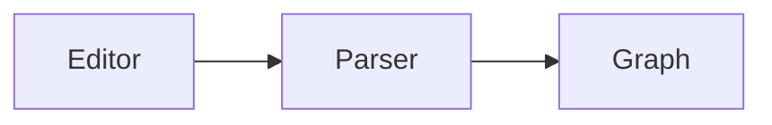

# Editor

The editor is CodeMirror 6 with live preview. You write plain Markdown, and the
editor shows the markup in the text itself.

## Note modes

A note has three modes. Press <kbd>⌘E</kbd> to go to the next mode.

| Mode | What you see |
|---|---|
| **Edit** | The editor with live preview. A heading has no hash marks, and a table looks like a table. |
| **Side by side** | Plain Markdown on the left, the preview on the right. The full source is always visible on one side. |
| **Read** | The preview alone, in a centered column with a larger font. |

kknow keeps the mode for each note. For example, you read a reference and edit
a draft. A note without its own mode opens in the default mode from
**Settings → Editor**.

## Saving

kknow saves a note 1 second after the last edit, and at once when you go to a
different note or window. <kbd>⌘S</kbd> saves now.

The save checks the disk first. Another program can change the note while you
type, for example an agent, git or a different editor. Then kknow does not
overwrite that version. It writes your text next to it as a copy
`Note (conflict 3f9a1c2b).md`. You lose neither version.

## Links

Type `[[` to link to a note. kknow shows the notes of the vault. Type to filter
them and press <kbd>Enter</kbd>.

| You type | kknow offers |
|---|---|
| `[[` | the notes of the vault |
| `[[note#` | the headings of that note |
| `[[note#^` | the block IDs of that note |
| `[[#` | the headings of the open note |
| `#ta` | the tags of the vault |

kknow inserts the file name of the note. If two notes have the same name, it
inserts the full path. It also adds the closing `]]`.

To open a link, hold <kbd>⌘</kbd> and click it. You can also put the cursor
in the link and press <kbd>⌥Enter</kbd>. A link to a heading or a block opens
the note at that line. A link to a missing note creates the note.

A plain click puts the cursor into the link, so you can change its text.

### Hover preview

Hold <kbd>⌘</kbd> and point at a link, in the editor or in the preview. After
a short pause, a popup shows the linked note. A link to `note#Heading` shows
only that section: the heading and the text up to the next heading of the
same or a higher level. A link to `note#^block` shows the paragraph of the
block.

- You can also point first and press <kbd>⌘</kbd> after that.
- Move the pointer into the popup to scroll it or to click a link in it.
- A click on the note name at the top opens the note at that section.
- <kbd>Esc</kbd>, a click outside or a different note hides the popup.
- If the note has no such heading, the popup shows the whole note and says so.
  A link to a missing note says that the note does not exist.

## Lists

A list shows a dot for each item. A nested list shows a ring, and a deeper one
a square. A task `- [ ]` shows a box. Click the box to mark the task as done.
The markup shows when the cursor is in it.

| Keys | Action |
|---|---|
| <kbd>Enter</kbd> | Next item. In an empty item, leaves the list. |
| <kbd>Tab</kbd> | Nest the item under the item above. |
| <kbd>⇧Tab</kbd> | Move the item one level up. |
| <kbd>⌥↑</kbd> / <kbd>⌥↓</kbd> | Move the item with its nested items. |

After each change kknow puts the numbers of an ordered list in order again.
The first number of a list stays, so a list can start at 5.

## Tables

Tables work as in Obsidian. A table always looks like a table. Click a cell to
edit its Markdown in place.

| Keys | Action |
|---|---|
| <kbd>Tab</kbd> / <kbd>⇧Tab</kbd> | Next / previous cell. Tab in the last cell adds a row. |
| <kbd>Enter</kbd> | Next row. In an empty last row, removes it and leaves the table. |
| <kbd>⇧Enter</kbd> | Line break in the cell. |
| <kbd>⌘Enter</kbd> | Leave the table. |
| <kbd>Esc</kbd> | Close the cell. |
| <kbd>⌥⇧</kbd> + arrow | Move a row or a column (in the `</>` source view). |

The toolbar above the table adds and removes rows and columns, aligns a column,
sorts by a column and swaps rows and columns. kknow aligns the columns of the
Markdown for you, as the Advanced Tables plugin does.

To select cells, drag from one corner to the other, or click the handles along
the edges. <kbd>⌘C</kbd> copies the selection as tab-separated columns, so you
can paste it into a spreadsheet.

To start a table, type `| Name` and press <kbd>Tab</kbd>.

## Images

```markdown
        path from the note or from the vault root
![[screenshot.png]]                file name, searched in the whole vault
    width 300 px; |300x200 sets width and height
```

To add an image, paste it with <kbd>⌘V</kbd> or drop a file on the editor.
kknow saves it into the `attachments/` folder at the vault root and inserts a
link. kknow never overwrites a file: it adds a number, for example
`shot 2.png`.

An image is never wider than the text column. Click an image to show it in the
full window.

::: info Images from the web
kknow shows only images from the vault. It does not load `https://…` images.
A note from another person must not tell a third-party server that you opened
it.
:::

## Code blocks

kknow colors the code by the language after the opening fence, for example
` ```rust `. Live preview shows the block as in the preview. Click the block
to edit its source.

Move the pointer over a code block to see the **copy** button in the corner.
It copies only the code, without the fences and the language name. The button
is in the editor and in the preview.

## Mermaid diagrams

A code block in the `mermaid` language becomes a picture in the preview:

````markdown

````


The colors follow your theme. If Mermaid cannot parse the diagram, the block
stays as text and shows the error with the line number.

## Find in the note

<kbd>⌘F</kbd> opens a search panel above the editor. It highlights all matches.

- <kbd>⌘G</kbd> and <kbd>⌘⇧G</kbd> go to the next and the previous match.
- Replace works for one match or for all matches.
- Checkboxes turn on case sensitivity, whole words and regular expressions.
- Selected text becomes the query.

<kbd>⌘⇧O</kbd> shows the headings of the note. Type to filter them and press
<kbd>Enter</kbd> to go to a heading.

## Font size

Each note has its own font size. Press <kbd>⌘=</kbd> for larger, <kbd>⌘−</kbd>
for smaller and <kbd>⌘0</kbd> for the default. The range is 70% to 200%. The
status bar has the same control with a slider.

## Line numbers

The line numbers button in the status bar shows or hides the line numbers.
**Settings → Editor** has the same switch. The numbers are on by default.

In the editor each line has a number. In Read mode the text has no source
lines, so the numbers show where each block starts: a paragraph, a heading, a
list item, a code block or a table. The numbers are the same as in the
editor, so you can find the place in the source.

## Edits outside the app

kknow watches each open vault. If git, sync or another editor changes a note,
kknow updates the window, the links and the search without a restart. If you
have unsaved changes, kknow does not overwrite them and shows a warning.
