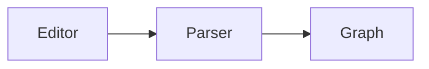

# Editor

The editor is CodeMirror 6 with live preview. You write plain Markdown, and the
editor shows the markup in the text itself.

## Note modes

A note has three modes. Press <kbd>⌘E</kbd> to go to the next mode.

| Mode | What you see |
|---|---|
| **Edit** | The editor with live preview. A heading has no hash marks, and a table looks like a table. |
| **Side by side** | Plain Markdown on the left, the preview on the right. The full source is always visible on one side. |
| **Read** | The preview alone, in a centered column with a larger font. |

kknow keeps the mode for each note. For example, you read a reference and edit
a draft. A note without its own mode opens in the default mode from
**Settings → Editor**.

## Saving

kknow saves a note 1 second after the last edit, and at once when you go to a
different note or window. <kbd>⌘S</kbd> saves now.

The save checks the disk first. Another program can change the note while you
type, for example an agent, git or a different editor. Then kknow does not
overwrite that version. It writes your text next to it as a copy
`Note (конфликт 3f9a1c2b).md`. You lose neither version.

## Tables

Tables work as in Obsidian. A table always looks like a table. Click a cell to
edit its Markdown in place.

| Keys | Action |
|---|---|
| <kbd>Tab</kbd> / <kbd>⇧Tab</kbd> | Next / previous cell. Tab in the last cell adds a row. |
| <kbd>Enter</kbd> | Next row. In an empty last row, removes it and leaves the table. |
| <kbd>⇧Enter</kbd> | Line break in the cell. |
| <kbd>⌘Enter</kbd> | Leave the table. |
| <kbd>Esc</kbd> | Close the cell. |
| <kbd>⌥⇧</kbd> + arrow | Move a row or a column (in the `</>` source view). |

The toolbar above the table adds and removes rows and columns, aligns a column,
sorts by a column and swaps rows and columns. kknow aligns the columns of the
Markdown for you, as the Advanced Tables plugin does.

To select cells, drag from one corner to the other, or click the handles along
the edges. <kbd>⌘C</kbd> copies the selection as tab-separated columns, so you
can paste it into a spreadsheet.

To start a table, type `| Name` and press <kbd>Tab</kbd>.

## Images

```markdown
        path from the note or from the vault root
![[screenshot.png]]                file name, searched in the whole vault
    width 300 px; |300x200 sets width and height
```

To add an image, paste it with <kbd>⌘V</kbd> or drop a file on the editor.
kknow saves it into the `attachments/` folder at the vault root and inserts a
link. kknow never overwrites a file: it adds a number, for example
`shot 2.png`.

An image is never wider than the text column. Click an image to show it in the
full window.

::: info Images from the web
kknow shows only images from the vault. It does not load `https://…` images.
A note from another person must not tell a third-party server that you opened
it.
:::

## Mermaid diagrams

A code block in the `mermaid` language becomes a picture in the preview:

````markdown

````


The colors follow your theme. If Mermaid cannot parse the diagram, the block
stays as text and shows the error with the line number.

## Find in the note

<kbd>⌘F</kbd> opens a search panel above the editor. It highlights all matches.

- <kbd>⌘G</kbd> and <kbd>⌘⇧G</kbd> go to the next and the previous match.
- Replace works for one match or for all matches.
- Checkboxes turn on case sensitivity, whole words and regular expressions.
- Selected text becomes the query.

<kbd>⌘⇧O</kbd> shows the headings of the note. Type to filter them and press
<kbd>Enter</kbd> to go to a heading.

## Font size

Each note has its own font size. Press <kbd>⌘=</kbd> for larger, <kbd>⌘−</kbd>
for smaller and <kbd>⌘0</kbd> for the default. The range is 70% to 200%. The
status bar has the same control with a slider.

## Edits outside the app

kknow watches each open vault. If git, sync or another editor changes a note,
kknow updates the window, the links and the search without a restart. If you
have unsaved changes, kknow does not overwrite them and shows a warning.
